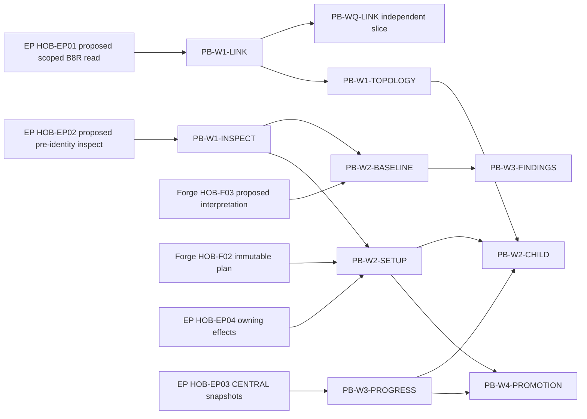

# Project bootstrap V1 — Workspace owning roadmap

**Owner:** Workspace. **Status:** all runtime/qualification nodes PLANNED. **NO_BUMP.**
This is the scoped implementation decomposition of onboarding/control plane in [ROADMAP.md](../ROADMAP.md), refining [repository onboarding](REPOSITORY_ONBOARDING.md), not a second planner or EP console. Read [the complete design](PROJECT_BOOTSTRAP_V1.md) and [non-executable DAG](PROJECT_BOOTSTRAP_V1_DAG.json).

| Node | Depends on | Deliverable / closure |
| --- | --- | --- |
| PB-W0 | none | Five-journey UX/intent contract, identity/reservation and owner/capability mapping |
| PB-W1 | PB-W0; Forge PB-F0 and EP PB-E0 contracts | Workspace Server's typed authorized HTTP projections/intents and safe draft storage; no peer CLI/SQL |
| PB-W2 | PB-W1; Forge PB-F2/PB-F7 and EP PB-E1 | Genesis/Managed create/adopt wizard with exact artifact/settings diff and role-bound plan decisions |
| PB-W3 | PB-W1; Forge PB-F4/PB-F5/PB-F7 and EP PB-E5 | Mode-correct progress/readiness, partial effects, recovery/readback and source-bound exports |
| PB-W4 | PB-W2, PB-W3; Forge PB-F6 and EP PB-E4 | History/publication-aware Genesis-to-Managed promotion, fenced activation and recovery UX |
| PB-WQ | PB-W2, PB-W3, PB-W4; qualified Forge PB-FQ and EP PB-EQ | Installed HTTP integration for all five journeys, desktop/mobile, five locales, accessibility and negative authority cases |

PB-W0 now has a versioned [Workspace intent/capability contract](PROJECT_BOOTSTRAP_W0_CONTRACT_V1.md)
and offline negative projection fixtures. This defines the five journeys and
owner boundaries but supplies no producer binding, endpoint, UI, provisioning
or installed qualification. PB-W1 and all later runtime nodes remain PLANNED.

PB-W0/W1 can advance contract-first without runtime services being complete; delivered user actions remain gated by actual compatible owner capabilities. Workspace qualification consumes peer evidence but is not a prerequisite of Forge PB-FQ or EP PB-EQ. The documentary DAG allocates Workspace work only; owner roadmaps decide peer implementation status and order.

Companions:
- Forge `docs/roadmap/PROJECT_BOOTSTRAP_V1.md` and `docs/roadmap/project-bootstrap-v1.json`.
- EP `docs/development/PROJECT_BOOTSTRAP_V1_ROADMAP.md` and `docs/development/PROJECT_BOOTSTRAP_V1_DAG.json`.
- Shared scenario catalogue: Forge `docs/architecture/PROJECT_BOOTSTRAP_QUALIFICATION_V1.md`, PB-01..PB-40.

All implementation is post-/parallel-autonomy productization as appropriate; no new edge blocks Mission 3. Design completion does not close FWV1-G003/G013 implementation or imply an installed onboarding UI. Existing policy/workset/priority authority remains unchanged.

## Holistic refinement — plan97, implementation unselected

Same PB-W0..WQ IDs/status/dependency history. These independently selectable subsets are grouping
under the existing nodes, not requirements to complete the entire parent first. All remain PLANNED.
Producer HOB-* proposals are exact, versioned and UNQUALIFIED; peer owner selects/qualifies them.

| Subset | Existing parent | Required local inputs | Producer proposal | Deliverable |
| --- | --- | --- | --- | --- |
| PB-W1-LINK | PB-W1 | PB-W0 | HOB-EP01 | Link verified configured project without scan or peer write |
| PB-W1-TOPOLOGY | PB-W1 | PB-W1-LINK | HOB-EP01, HOB-F01 | Confirm one authority and independent children |
| PB-W1-INSPECT | PB-W1 | PB-W0 | HOB-EP02 | Inspect chosen source safely before full initialization |
| PB-W2-BASELINE | PB-W2 | PB-W1-INSPECT | HOB-EP02, HOB-F03 | Version-bound scoped technical baseline |
| PB-W3-FINDINGS | PB-W3 | PB-W2-BASELINE | HOB-F01, HOB-F03 | Discuss evidence and preserve disposition history |
| PB-W2-SETUP | PB-W2 | PB-W1-INSPECT | HOB-F02, HOB-EP04 | Exact create/adopt preview and separate required decisions |
| PB-W3-PROGRESS | PB-W3 | PB-W0 | HOB-EP03 | CENTRAL progress and same-operation recovery |
| PB-W2-CHILD | PB-W2 | PB-W1-TOPOLOGY, PB-W1-INSPECT, PB-W2-SETUP, PB-W3-PROGRESS | HOB-F02, HOB-EP04 | Add scoped child without replacing authority or invalidating unrelated work |
| PB-W4-PROMOTION | PB-W4 | PB-W2-SETUP, PB-W3-PROGRESS | HOB-F02, HOB-EP04 | Explicit safe history publication and mode activation |
| PB-WQ-LINK | PB-WQ | PB-W1-LINK | HOB-EP01 | Qualify independent basic link slice |
| PB-WQ-ASSESS | PB-WQ | PB-W2-BASELINE, PB-W3-FINDINGS, PB-W3-PROGRESS | HOB-EP02, HOB-EP03, HOB-F03 | Qualify baseline/findings with authority negatives |
| PB-WQ-SETUP | PB-WQ | PB-W2-SETUP, PB-W3-PROGRESS | HOB-F02, HOB-EP04 | Qualify individual create/adopt slices before aggregate |

**Recommended next selection:** PB-W1-LINK/PB-WQ-LINK, bounded existing configured-project visibility.
Only a qualified EP HOB-EP01 scoped topology snapshot and own reference handling are mandatory;
Forge context is optional. No scanner, new project/adopt/promotion, complete PB-FQ/PB-EQ, installer,
signing or multi-repo parallelism gate. Not selected/started by plan97. Manual reference is an explicit
UNVERIFIED fallback, not verified linking. Pre-identity inspect, scoped baseline/findings, exact setup/
progress, child extension and promotion follow in separately qualified slices. Optional analyses do not
block empty creation; a genuinely required profile analysis remains a scoped setup gate.

Peer boxes are requirements/proposals, not allocated work or L4 peer PASS. Dashed/optional deep
analysis dependencies are expressed in acceptance profiles, not hidden unconditional setup edges.
The full [machine projection](PROJECT_ONBOARDING_CROSS_PRODUCT_DAG_V1.json) preserves original
peer graphs: EP PB-EQ→Forge PB-F0 contract; Forge PB-FQ→EP PB-EQ; Workspace full PB-WQ consumes
both. Neither peer Q waits on Workspace. The documentary D97 graph is separate and non-executable;
EP execution/admission DAG is not copied or changed. All graph edges point prerequisite→consumer.

Traceability: [HOB-R01..20 / HOB-01..18](PROJECT_ONBOARDING_SCENARIOS_V1.json), with all PB-01..40
IDs preserved at their immutable owning catalogue. Design finalization needs independent complete
Quality/Security/UX, owning checks/protected delivery and exact-main document readback, not a
functional onboarding PASS. Older runtime evidence/budgets are not reopened by this refinement.

## Plan103 selected setup subset: saved concept baseline preview

CONCEPT_BASELINE_PREVIEW is a bounded subset of the existing PB-W2-SETUP identity, not full setup/adoption/EP/PB-W2. Saved concept → explicit exact saved-source/purpose check → actual R52 document/open-question proposal → original read-only reopen. Only portable-docs/1.0.0 authority/GENESIS/LOCAL_POSIX; [own contract](WORKSPACE_CONCEPT_BASELINE_V1.md). Existing nodes/parents/dependencies retain their full-family meaning. No additional EP/R51/discovery/installer gate applies to this selected subset. Full parent implementation_selected remains false.

Canonical owningPATCH2.8.26; plan103 protected sourcePR169/maina9f43228f0ec2c57d1a3ca1e52442a8d953da65d, reviewedb231728f1772e08bd795946f708812ee22f7f1f4. Corrections12/qualificationruns5 remain cumulative; complete scoped candidate Quality/Security/UX and actual qualified R52 final96e1 binding accepted. Documentary [NO_BUMP finalization](WORKSPACE_CONCEPT_BASELINE_FINALIZATION_V1.md), its checks/reviews/protected merge and NEW exact-final-main installed acceptance remain separate. Six safe candidate images/seven immutable HTTP200/hash readbacks are [available](https://github.com/pcvantol/workspace/tree/c7920e88fb20bc35a8d3404a1cd9077ea1ae2b9e/docs/qualification/plan103-candidate-proof-20261013); original image/recovery/failure pins remain unchanged. Full parent/onboarding is not delivered. Plan102 CLOSED15/27; PR160/LINK parked2/3/1.
