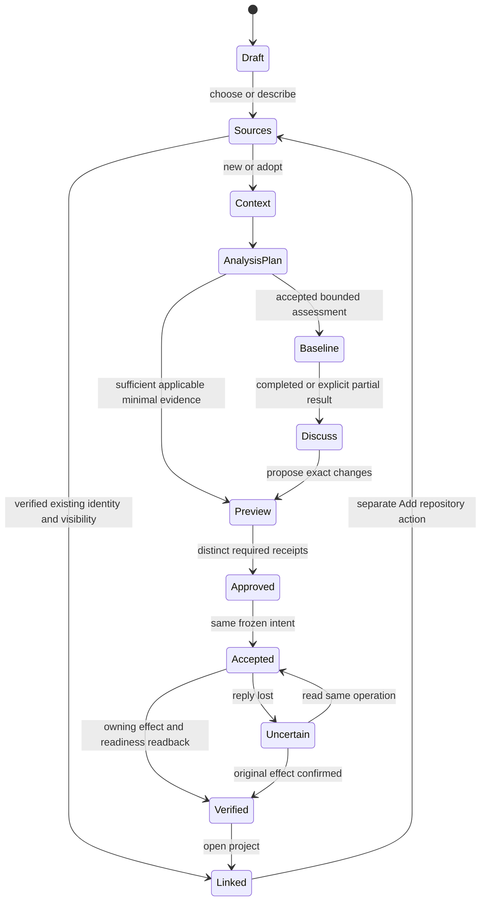

# Holistic project onboarding — plan97 design

**Assignment:** L4-HOLISTIC-PROJECT-ONBOARDING-DESIGN-DAG-V1-20261011. **DESIGN_ONLY / NO_BUMP.**
Implementation remains PLANNED; every new HTTP shape below is PROPOSED, not available.
Source observations: Workspace `889eb61d487b1374a63107e46e7d124ae67b77e3`, Forge
`f819196e9c025163be40c8e71693a3def4b78bc2`, EP `05e530d6339cb1c16b1e8f4814347578c5fd761c`.
These do not replace the qualified Forge2.12.1 consumer pin or old receipts.

This is the experience refinement of [repository onboarding](REPOSITORY_ONBOARDING.md),
[bootstrap](PROJECT_BOOTSTRAP_V1.md), [W0](PROJECT_BOOTSTRAP_W0_CONTRACT_V1.md),
[owning roadmap](PROJECT_BOOTSTRAP_V1_ROADMAP.md) and its existing PB nodes.
[Contract proposals](PROJECT_ONBOARDING_CONTRACT_PROPOSALS_V1.json),
[offline walkthroughs and traceability](PROJECT_ONBOARDING_SCENARIOS_V1.json),
[cross-product non-executable projection](PROJECT_ONBOARDING_CROSS_PRODUCT_DAG_V1.json)
and [wireframe gallery](onboarding-design/README.md) are one delivery.
This document owns proposed Workspace presentation, not peer schema or execution authority.

<a id="journeys"></a>

## 1. One product story, three clear entrances

Project kiezen/beschrijven → bronnen bevestigen → veilig begrijpen → bevindingen bespreken
→ exacte inrichting besluiten → owning voortgang teruglezen → project openen.
At the first screen the choices are **Nieuw project**, **Project koppelen**, **Code adopteren**.
The selected project later offers **Repository toevoegen** and **Online publiceren**.
Genesis/Managed are explained local/remote delivery choices inside those journeys, not five technical start buttons.

| User journey | Relation to retained PB routes | Meaning and first bounded outcome |
| --- | --- | --- |
| New project | NEW_GENESIS or NEW_MANAGED, explicitly selected later | Save a product draft, then local foundation or explicit remote birth. No automatic publication |
| Link a configured project | Existing-identity read projection; PB-10, not an extra create route | Verify existing EP project/authority/attachment and add an authorized Workspace reference. No scan, file/settings writes, duplicate project or re-adoption |
| Adopt code | ADOPT_GENESIS or ADOPT_MANAGED | Understand existing content/history, propose only missing/different setup. A README-only remote is existing content |
| Add repository | Scoped refinement under existing project, using create/adopt only if needed | Keep project ID, authority repo and unaffected decisions. Child ≠ submodule; monorepo module ≠ independent repo |
| Publish a local project | PROMOTE_GENESIS | Same IDs and ancestry; explicit publication/history/governance boundary. Never silent mode fallback |

Fork/import as a **new product** is a separate explicit identity decision, outside basic linking.
Migration/history rewrite, move to another project, removal and replacement of the authority repo
require their own future proposals; none is concealed in Add repository. Selecting an existing
project does not silently change its policy. Multiple physical attachments are not multiple logical projects.

<a id="screens"></a>

## 2. Screen contract and transitions

Each screen has a small fixed summary, its current owner/freshness and a contextual chat panel.
No hashes, tokens, role enums or operation IDs are mandatory user inputs. Optional **Bronnen en details**
shows exact version metadata and bounded diffs. Workspace saves drafts; saving/Next is never effect approval.

| Screen | User goal / visible input | Proposed data and source / owner | Allowed effects, checkpoint and next action | Non-success and recovery |
| --- | --- | --- | --- | --- |
| S1 Project start | Pick three entrances; project search or one-sentence purpose | Accessible existing identities from EP; Workspace recent references, clearly separated from discovery | Read authorized inventory and save own draft only; checkpoint DRAFT; Continue | EMPTY: no projects; DENIED: scope unavailable, not empty; OFFLINE: retained draft; no peer provisioning inferred |
| S2 Sources | Confirm authority repo and included children; choose eligible EP placement or remote owner/name/visibility when required | EP identity/resource observations; Forge existing canonical document mappings; actual observation age | Read chosen metadata; no crawl or repository write; checkpoint SOURCE_VECTOR; Understand project or Finish linking | CONFLICT for duplicate/fork/authority claim, dirty or nested target; unknown history distinct from no history; return to scope without reset |
| S3 Understand | Chat: goal, users, current situation, non-goals, constraints, uncertainty | Existing authorized docs/issues/ADRs are source facts; Forge interpretation is labeled assumption/proposal; human direction separately recorded | Save conversational context under current access; no model call implied by opening a document; checkpoint CONTEXT_REVISION; Analysis plan or Setup preview | Missing docs → questions, never request user invent architecture; denied evidence unavailable; model transfer absent consent → local/source-only summary |
| S4 Analysis plan | Select understandable analysis cards; exclusions; cost/time/data scope; explicit Start analysis only when effect authorization is needed | EP capability/profile inventory; cached owner reports with exact stack/tool/revision/coverage; Forge recommended gaps | Passive bounded metadata reads reuse existing read authority; paid/model/script/network work requires distinct accepted assessment scope; checkpoint ANALYSIS_PLAN; Start or Continue with partial basis | UNSUPPORTED scanner, no EP, expired consent, changed revision; explain owner and alternative without hidden provider start |
| S5 Baseline progress | Follow phase cards, pause/cancel where owner supports it; no technical fields | Authorized EP CENTRAL snapshots; Forge interpretation references, each independently fresh | Read same server operation; no UI scheduler; checkpoint OWNER_RECEIPTS; Discuss findings | PARTIAL, FAILED_TO_RUN, operator wait, Forge review and external gate shown separately; reconnect reads same operation; no second start |
| S6 Findings | Group by component/impact; inspect one finding, dispute/defer/ask chat; choose next discussion | Existing issue status + EP findings + Forge interpretation + human disposition, never one overwritten status | Read evidence; save own discussion; governed disposition remains an owner proposal until receipt; checkpoint BASELINE_DIGEST; Setup proposal or Open project | Missing evidence, disputed/duplicate finding, stale source, partial multi-repo; original owner/status/previous decisions retained |
| S7 Setup preview | Review readable before/after files/mappings/settings and each distinct required decision | Forge frozen artifact plan; EP expected HEAD/tree/provider settings, B8R declarations; exact owners | Collect separate direction/architecture/effect/publication receipts for SAME plan; checkpoint FROZEN_PLAN; one execution confirmation only after required decisions | Dirty checkout, stale hashes/plan/role, missing mandatory evidence, unsupported host rule → disabled with reason; editing materially invalidates affected approvals |
| S8 Progress / open | See accepted vs actually configured vs ready for a stated action; Open project | EP effect/governance/attachment readback + Forge scoped readiness vector | Read/restore same operation; open own reference; no first Mission; checkpoint VERIFIED_RESULT | EFFECT_UNCERTAIN: query original ID, never new create; partial effects stay visible; cancellation not rollback; no destructive compensation |
| S9 Add repository | Confirm existing project, new/existing child identity and purpose; scoped impact preview | EP existing authority and new child observation; Forge impacted contracts/components | Reuse S2/S4/S6/S7 for CHILD scope; independently version child effects and later readback | Incomplete child is not engineering-ready; unaffected existing repo proofs/work remain valid for their scopes; authority replacement not offered here |

Linking S1→S2→S8 is a deliberately short path: qualified identity/visibility is enough to add a
Workspace reference. Analysis, setup and promotion are optional later actions. It displays
engineering readiness as UNKNOWN or the actual owner result, never fabricates READY.
New/empty goes S1→S3→S2→S4(passive/minimal)→S7→S8; a deep scan is not a mandatory empty-project gate.
Adoption normally traverses S2→S3→S4→S5→S6→S7→S8. A required profile analysis cannot be skipped to
make its current acceptance pass; an optional debt investigation can be deferred explicitly.



BLOCKED, DENIED, STALE, CONFLICT and PARTIAL are annotated owner outcomes at every state,
not automatic transitions to a different delivery mode. A revoked session hides protected data and
disables effect controls while retaining the private durable intent for later authorized reconciliation.

<a id="ux"></a>

## 3. Concrete wizard/chat UX

The screen summary answers **Which project? What happens next? Who is waiting?** Chat supplies
context and suggestions; it never serves as an invisible approval collector. Example:

- User: “Deze service bestaat al; ik wil begrijpen wat ontbreekt.”
- Assistant: “Ik heb de README en drie architectuurbesluiten als bron. Twee beweringen spreken elkaar tegen.
  Wil je eerst de bronnen bespreken of de voorgestelde analyse bekijken?”
- Analysis card: “Bronnen lezen — 1 geselecteerde repository, twee documenten; child uitgesloten. Geen scripts of externe upload.”
- Optional deeper card: “Tests uitvoeren — EP, maximaal 10 minuten, geïsoleerd; repositoryscripts kunnen
  code uitvoeren. Externe toegang uit. Niet ondersteund op deze stack.” No Start is enabled for it.
- Finding: “Authenticatie: README zegt sessies; codebeschrijving toont API-sleutels. Waargenomen bron,
  aanname en nog onbeoordeeld securityrisico zijn afzonderlijk zichtbaar.”
- Setup: “Bestaande visie behouden. Architectuurbesluit toevoegen. Geen bestanden verwijderen.
  Repositoryinstellingen veranderen alleen volgens het getoonde voorstel.”

**Desktop:** at ≥1000 logical pixels, navigation/project tree 220px, summary 440–680px and optional
chat 300–420px. Content gets extra space rather than stretching sentences indefinitely. **640–999px:**
one main column; chat/detail opens a named sheet with return focus. **<640px:** stack sections,
move tree into Sources sheet, wrap action bars; minimum effective controls 44px, no clipped decisions.
No mandatory horizontally scrolling form. Long diffs have their own labeled scroll region and finite pagination.

macOS26 minimum remains the product target. Proposed native controls use system materials/Liquid Glass
for toolbar/sidebar only, solid high-contrast content behind long evidence text, system appearance and
Reduce Transparency/Increase Contrast alternatives. Palette uses the existing Workspace accent family;
no new reading of personal wallpaper is required for this document. Design examples show light/dark;
color is decorative, status always has text and icon. Do not blur secrets/content into decorative surfaces.

Keyboard order: heading → scope summary → main tree/cards → detail → chat → action bar. Space toggles
checkboxes; arrow keys navigate a real outline; Enter opens the focused item; Escape closes detail and
restores the originating item. Primary effect confirmation is never an unqualified global Return shortcut.
Async updates preserve selection and focus by stable logical ID; destructive/irreversible steps use a
named confirmation with explicit target. VoiceOver exposes hierarchy, included/excluded state, owner,
result/coverage and age; polite announcements on meaningful phase/blocker changes, not every poll.
Accessible alternatives list dependencies as text, and every visual wireframe has a reading order/caption.

[Locale table in the gallery](onboarding-design/README.md) specifies en/nl/de/fr/es labels and expansion
requirements. Machine IDs/contracts/digests are unchanged; dates/numbers/plurals follow locale.
German/French/Spanish expansion +40%, multiline buttons, Dynamic Type 200%, RTL is not claimed.
Translations here are design copy for all key decisions, not a claim implementation localization ran.

<a id="analysis"></a>

## 4. Technical baseline and analysis authorization

A baseline is a version-bound collection of evidence, not a score or successful pipeline badge.
Every report records analysis_id, owner, scope/repo revision vector, profile/tool/version, supported
input, start/end/observed time, completeness/coverage/exclusions, consent reference, limits,
result kind, safe-stop state and immutable digest/reference. TDE assessment retains its own policy
and qualification; broader technical debt is not certified by a TDE PASS.

| Analysis family | Inputs / supported scope | Evidence owner and meaning | Effect class / limits and fallback |
| --- | --- | --- | --- |
| Product/context | Approved vision, roadmap/DAG, ADRs, issues/PR statuses and prior decisions | Canonical source owner; Forge interpretation with citations and confidence | Bounded authorized report/docs reads; stale docs ≠ current facts; no provider on open |
| Architecture | Stack/component manifests, interfaces, data flows/storage, trust boundaries, internal/external dependencies | EP tool/static evidence; Forge compares documented and observed architecture | Stack support declared per tool; no execution from repo manifests; undocumented area NOT_ASSESSED |
| Quality | Static complexity/duplication/hotspots, test inventory, coverage and actual build/validation feasibility | Tool/TDE owners preserve actual versions/profiles; EP run references | Reading old coverage ≠ running tests; script/test runs need isolated assessment authority and finite tool/time budget |
| Security | Supported code/dependency/secrets tools, security alerts and workflow/governance configuration | Tool evidence + EP scoped execution; Forge interpretation separate | No raw secret value in chat/log/export; denied network/provider/security data explicitly incomplete; findings keep evidence location, not leaked value |
| Documentation | Presence, age, citations, contradictions, ownership, missing required artifact mappings | Source facts and Forge assessment | Exists, missing, stale, contradictory, adequately supported, NOT_ASSESSED are separate labels |
| Cross-repo coherence | Version/schema/API contracts, shared libraries, cycles, ownership/release coupling, integration tests | EP report per revision vector + Forge project interpretation | Scope impacted edges; no fabricated dependencies from filenames; unknown integration coverage remains UNKNOWN |
| Debt | Evidence-bound category, impact, uncertainty, explicit estimate assumptions/range | Forge interpretation with tool/source references + human disposition | No arbitrary overall score; estimated effort is not runtime cost or accepted priority |

PASS, FINDINGS, FAILED_TO_RUN, UNSUPPORTED, PARTIAL and NOT_ASSESSED are disjoint report outcomes.
PASS is scoped to the tool/profile/revision and may coexist with findings from other tools.
A cancelled run retains partial evidence and original limits; restart never silently renews its authority.

**Pre-initialization inspection avoids a circle:** EP first validates a bounded caller/source/placement
reference under proposed INSPECT_READ authority, which can exist before a committed project identity.
It may disclose only permitted metadata/content; it cannot register, write, execute hooks, contact remotes
or issue credentials. A provisional source handle is not a project ID. Deeper assessment has separately
accepted exact inputs, tools, network/data-transfer allowlist, maximum elapsed time/cost, output scope,
expiry and stop/readback rights. Current EP producer-readback requiring an already active bound project
is NOT reused as authorization for this pre-project inspection. Missing support is a blocked edge HOB-EP02.

Model interpretation is a separate data-transfer choice: exact recipient/model category, redacted payload
classes, purpose, retention and cost cap. No external scan/model upload follows from link/inspect consent.
Repository README/AGENTS/hooks/test instructions are untrusted data. Neither Forge prompts nor EP
runners can expand admission from them. Disable hooks, symlink traversal, dependency install scripts and
ambient network by default; allow only explicitly qualified tools/effects under owning isolation.
Dirty/staged/untracked content is inventoried without stashing/committing/cleaning. Findings use redacted
references; repository secrets and arbitrary private paths never become portable evidence fields.

<a id="findings"></a>

## 5. Evidence, findings and lasting knowledge

The immutable **AnalysisSnapshot** holds source_revision_vector, analysis/report IDs and digests,
profile/tool compatibility, coverage, exclusions and independently timestamped owner evidence.
A **FindingRecord** keeps stable owner finding_id and fingerprint (normalized tool/rule/repo/location/
evidence identity), component/revision, type, impact/severity, separate priority, confidence,
original issue/report status, owner/disposition, redacted evidence reference and proposed next action.
Cross-tool matches create SAME/RELATED links with match basis and confidence; no automatic deletion
or claim identical merely because descriptions look similar. Dedup never overwrites the original owner IDs.

Three records remain separate: **source observation → Forge interpretation → human decision receipt**.
Workspace stores display references/drafts; EP CENTRAL keeps actual execution evidence; canonical
project documents/issues retain approved meaning. Forge Project Context/Knowledge references these
snapshots and governed interpretations. Workspace does not create a second engineering datastore.
A discussion/disposition proposal may be saved, but only the authorized owning decision service commits
risk acceptance/priority/canonical edits. Proposed HOB-F03 supplies that boundary; no chat “yes” fakes a receipt.

Disposition history is append-only with actor/role, source digest, decision revision and supersedes reference:
OPEN, DISPUTED, DEFERRED (review trigger/date), ACCEPTED_RISK (explicit scope/expiry), RESOLVED
(with evidence), REOPENED. New scans may link/reopen after changed evidence; they never erase older
accepted risk or mark an issue closed. An unknown owner/historical disposition is visibly UNKNOWN.
Immutable exports carry filtered scope, exact snapshot references and redacted sources, no raw prompts.

Readiness is **per requested action**, not a universal green project badge:

| Requested action | Mandatory blockers | Can remain visible as deferred / unknown |
| --- | --- | --- |
| Link/read own project | Identity conflict, absent visibility authority, unverified canonical declaration | Deep analyses, optional docs, noncritical debt; attachment offline is unavailable, not identity deletion |
| Scoped inspection | Unresolved target/access/isolation, unsupported required inspection primitive | Unassessed optional tool/architecture assumptions |
| Apply setup | Wrong plan/HEAD/settings, dirty ownership, missing applicable required validation/security/role/effect receipts | Optional debt not in the accepted setup scope, explicitly retained |
| Publish/promote | Unknown history/sensitive-data outcome, wrong visibility/license/publication authority or ancestry | Only unrelated optional debt; privacy/publication blockers cannot be deferred past disclosure |
| Start later engineering | Actual Forge/EP per-action DoR/authorization/contract/attachment gates | Other components' separate unneeded reports; no Mission is started by onboarding |

A current acceptance defect cannot be reclassified as a future Candidate to make that acceptance green.
Findings become discussion or proposed work only; not every finding warrants a Mission.

**Refresh:** owner revisions and source vector determine freshness, not Client retrieval time. A source
change during analysis preserves the old result, labels it historical and blocks incompatible decisions;
propose a targeted new run for changed repos/affected contracts. Additional child analysis produces a
new vector and related snapshot; unaffected results remain valid in their scopes. A projectwide
compatibility claim needs actual evidence for the new edges/vector. No compulsory whole-project retest
for every read or naming edit. Cached report reuse shows original age/profile/tool/revision and exclusions.

<a id="contracts"></a>

## 6. Data and authority contracts

The exact proposed routes, versions, request/response fields and synthetic examples live in
[the machine-readable proposal](PROJECT_ONBOARDING_CONTRACT_PROPOSALS_V1.json).
A producer must explicitly accept/qualify them before binding. Authenticated versioned HTTP is the sole
interproduct path. No peer CLI/import/SQL, Client→Agent file instruction, Console scraping or reusable
provider token in the Client. Existing grants cannot be widened by adding an onboarding field.

| Boundary | Observed basis / status at pinned source | Missing operation/data | Owner / exact proposal |
| --- | --- | --- | --- |
| Workspace Client→own Server | Existing paired own API/drafts/chat; not an onboarding adapter | Typed scoped onboarding draft/projection and role-specific visibility | Workspace HOB-W01; future PB-W1-LINK/PROGRESS; no scheduler |
| EP logical discovery/link | B8R committed declarations/schema42/paired Agent attach + read-only topology diagnostic documented; this is not a qualified Workspace discovery bearer | Authenticated finite project/repo/attachment read snapshot and visibility scope | EP HOB-EP01 under PB-E0/E1; no attach write from linking |
| Pre-project inspect / optional assessment | Bootstrap inventory/admission design; complete PB-E0/E1 still PLANNED | Pre-identity bounded read access, distinct assessment admission/profile/tool/isolation limits | EP HOB-EP02 under PB-E0/E1; no borrowed project bearer or dummy Mission |
| CENTRAL progress/readback | Existing producer compatibility and submission/by-identity/artifact readback; bound consumer/project/authority restrictions apply | Onboarding/assessment kind, authorized Workspace read projection, operation-phase snapshots and limited correlation | EP HOB-EP03 under PB-E5; existing Action submission contract not silently changed |
| EP setup/child effects | B8R primitives + PB-E2/E3/E4 composition PLANNED | Frozen plan admission/effect receipts and explicit child attachment/create/adopt mapping | EP HOB-EP04, retaining existing EP owner ledger/leases and B8R schema |
| Forge context/findings | Project Intelligence design + delivered advisory primitive, not full onboarding evidence broker | Source-bound context, baseline interpretation/disposition and applicable readiness | Forge HOB-F01/F03; no new planner or decision authority in Workspace |
| Forge exact setup | Bootstrap manifest/PB-F0..7 PLANNED, not storage-init scaffolding | Immutable artifact/adoption plan/decisions/readiness and child impact | Forge HOB-F02; reuse manifest schema, never second Workspace template renderer |
| Optional progress relay | Forge's EP consumer can read current submissions within its own qualified scope | Authorized filtered projection with ORIGINAL CENTRAL provenance and caller visibility | Forge HOB-F04, alternative only if peer expressly accepts; not a broad bearer fallback |

Existing reference routes are listed separately from proposed routes in the contract JSON. EP public
producer-compatibility exposes compatibility only; it cannot discover private projects or grant scope.
Existing Forge Workspace status bearer accepts only GET /v1/instance and /v1/status; it is not authorized
for the new context/plan routes. Existing EP submission readback is accepted-consumer scoped; Forge
credentials must not be passed to Workspace. If EP cannot provide direct Workspace progress scope,
a narrowly authorized Forge relay may be proposed with immutable EP evidence refs; until qualified,
show UNAVAILABLE rather than scraping CENTRAL/Console.

| Data/effect | Reserves / writes | Decides | Durable owner / Workspace role |
| --- | --- | --- | --- |
| Own draft / preferences | Workspace | User edits own draft | Workspace state; no grant or canonical project |
| Provisional target/source reservation | EP under accepted inspection/provision scope | Owning authorized caller | EP ledger; Workspace reads reference, never invents committed ID |
| Logical project/repo/authority | Committed repo declaration; EP validates/registers | Applicable topology/effect owner | EP logical identity + project source; Workspace display only |
| Product/architecture/manifest plan | Forge builds proposed interpretation/plan | Actual Business/Architecture decisions, bound digest | Canonical project source/Forge receipts; Workspace renders and forwards permitted intent |
| Tool runs, leases, local/remote effects | EP | EP admission + accepted exact effect authority | EP CENTRAL/provider actual readback; no Workspace execution queue |
| Finding interpretation/disposition | Forge interprets, owning issue/tool state separate | Authorized humans via owning governance | Source/tool/EP evidence + Forge references/receipts, not client overrides |
| Readiness | Forge interpretation of compatible scoped owner evidence | Existing action-governance remains separate | Forge readiness vector; not Client button enablement as proof |

Cross-product snapshots are **not atomic**. A composite Workspace view carries owner-specific snapshot
IDs/revisions/digests, observed_at/fetched_at, compatibility and source vector. Join only matching
logical scope, plan revision and run/operation references. Out-of-order updates are discarded per owner;
unknown/stale/mismatched components remain visible and disable only their dependent effect controls.
No global revision or last-fetched timestamp can convert stale EP evidence into current Forge approval.

<a id="sequences"></a>

## 7. Sequences and recovery

These are contract sequences, not executed network calls. WS is own Server; C is native Client.

```mermaid
sequenceDiagram
  participant C as Workspace Client
  participant W as Workspace Server
  participant F as Forge
  participant E as EP
  C->>W: Save new product draft (no effects)
  W->>E: PROPOSED inspect/reserve exact target, bounded read scope
  E-->>W: provisional reference, capability/source snapshot
  W->>F: PROPOSED immutable local/remote bootstrap plan
  F-->>W: artifact/settings diff and required decisions
  C->>W: distinct required role and effect decisions
  W->>E: PROPOSED admit SAME frozen plan and operation
  E-->>W: accepted receipt (not ready)
  W->>E: authorized CENTRAL operation snapshot
  W->>F: result refs for scoped readiness
  F-->>W: readiness vector
  W-->>C: actual configured state, Open project; no Mission
```

```mermaid
sequenceDiagram
  participant C as Client
  participant W as Workspace Server
  participant E as EP
  participant F as Forge
  C->>W: Link existing project
  W->>E: PROPOSED authorized B8R topology snapshot
  E-->>W: committed IDs/authority and attachment freshness
  W->>W: save own verified project reference (no peer write)
  W->>F: optional PROPOSED context read with own scope
  F-->>W: available context or UNAVAILABLE
  W-->>C: linked; readiness separate; no scan/setup
  C->>W: optional Adopt existing code (separate action)
  W->>E: scoped passive source inventory
  W->>F: interpret sources and propose analysis
  C->>W: accept bounded assessment only if needed
  W->>E: PROPOSED separate assessment admission
  E-->>W: per-tool/vector evidence; partial explicit
  W->>F: baseline interpretation and frozen adoption plan
  W-->>C: discuss then distinct exact setup decisions
```

```mermaid
sequenceDiagram
  participant C as Client
  participant W as Workspace Server
  participant F as Forge
  participant E as EP
  C->>W: Add child to existing project
  W->>E: PROPOSED verify existing authority + selected child
  E-->>W: bounded source vector; no identity rewrite
  W->>F: PROPOSED affected interface/roadmap impact
  F-->>W: child mapping and exact proposed effects
  C->>W: required child-specific decisions
  W->>E: PROPOSED attach/create/adopt under SAME project
  E-->>W: child receipt and partial readiness
  W-->>C: new child state; existing unaffected scope retained
  Note over W,E: lost reply: durable original operation only
  W->>E: PROPOSED read original operation/by-identity
  E-->>W: actual prior effect or STILL_UNCERTAIN
  W-->>C: supported resume/readback, never second create
```

Analysis uses an independent assessment_id/operation_kind and source vector; a real Mission/Action/run
reference is included only if one actually exists and is authorized for the requested assessment.
Phase cards distinguish implement/check/finalize and human waits for later genuine Actions without
rebuilding the later execution monitor. Operator wait, Forge review and external gate have different
owners and permitted next actions. Intent is stored before dispatch; identical retry bytes/idempotency
key reconcile the original operation, changed bytes conflict. After revoke/expiry, stop further reads/
effects, conceal protected cached details, retain redacted durable references; reauthorization is a
separate owner action, never a Client-generated grant. Cancellation displays actual partial effects;
no automatic remote deletion, hidden history rewrite or reissue.

<a id="children"></a>

## 8. Adding repositories and readiness impact

Existing project → choose new/existing repository → validate actual identity/relationship → bounded
inspection/minimal baseline → affected contracts/architecture/roadmap preview → separate applicable
mapping/effect decisions → EP attach/readback → Forge scoped impact/readiness.
No change of authority_repository_id through this flow. A copied child declaration in a fork is a
conflict until the owning identity decision resolves it. A module in a monorepo may be represented as
component evidence without minting repository ID. The UI never creates submodule links automatically.

Use independent child receipts and a new topology revision; compare against expected current authority.
A concurrent child update is a conflict/refresh, not overwrite. Existing approved running work remains
bound to its original source/action snapshot and authorization; a new child neither cancels it nor adds
parallel writer rights. A new cross-repo contract needs new evidence for its relevant edge; old analysis
results remain historical and referenced. Pending child does not invalidate unrelated existing repo
readiness, nor does the project-level summary silently classify the child as engineering-ready.

<a id="roadmap"></a>

## 9. Delivery decomposition and selection advice

Existing PB-W0/W1/W2/W3/W4/WQ identities and statuses remain. New subsets refine them in
[the owning DAG](PROJECT_BOOTSTRAP_V1_DAG.json); owner peer IDs are unchanged in the
[cross-product projection](PROJECT_ONBOARDING_CROSS_PRODUCT_DAG_V1.json).
Documentary plan97 delivery, product roadmap and EP execution DAG are separate graphs. No roadmap
edge is an executable admission or a peer assignment. Forge PB-FQ consumes EP PB-EQ; EP PB-EQ
consumes Forge PB-F0 contract, not PB-FQ. Workspace PB-WQ consumes both; no peer waits for Workspace.

Recommended first **selectable, not selected** vertical slice: PB-W1-LINK + PB-WQ-LINK.
Minimal dependency is EP HOB-EP01 qualified finite authorized B8R read snapshot + Workspace own
project-reference/draft semantics. Forge HOB-F01 context is optional; absence shows UNKNOWN rather
than blocking link visibility. No create/adopt effects, scans, paid interpretation, child mutation,
whole PB-EQ/PB-FQ, installer or promotion prerequisite. Peer acceptance/qualified read scope is missing;
if it is not delivered, prepare offline consumer contract tests but keep link button disabled. An
alternative manual saved reference is clearly UNVERIFIED and is not a verified link completion.

Then select scoped inspection/baseline/findings (PB-W1-INSPECT/PB-W2-BASELINE/PB-W3-FINDINGS),
exact setup + CENTRAL progress, child extension, and lastly publication-aware promotion. Qualify each
independent slice before the aggregate five-route PB-WQ. Deep scanners, provider-specific birth,
parallel multi-repo writing, full autonomy and richer ongoing Action monitor remain later, each with
specific owner/runtime boundaries. Deep analysis can be mandatory for a particular accepted profile;
that does not become a universal prerequisite for every linked project.

<a id="acceptance"></a>

## 10. Design acceptance and traceability

[Scenario JSON](PROJECT_ONBOARDING_SCENARIOS_V1.json) retains PB-01..40 as an immutable referenced
catalogue and maps additional HOB-01..18 walkthroughs and HOB-R01..20 requirements to sections,
capability families, PB subsets and future acceptances. Walkthroughs use synthetic examples only.
Acyclicity/reference/schema/link checks are documentary evidence, not a performed scan or onboarding PASS.

Independent Quality/Security/UX must review the complete package, including every wireframe and
proposal/example; meaningful corrections are booked once per integrated formal round after the first
full review. New design budget starts0/3; old plan96 source9/9 and additional2/2 remain untouched.
Mandatory owning validation and protected required CI apply without weakening checks. This design
needs protected delivery, ordinary owning finalization, exact-main artifact/document readback and
terminal registry. It needs no installed/onboarding GUI or live-provider matrix for unchanged product.

Open implementation edges are explicit, with alternatives above: scoped project discovery, pre-identity
inspection authority, assessment isolation/admission, CENTRAL onboarding snapshots, source-bound
Forge interpretation/disposition, immutable plan/child mapping and promotion publication. No unknown
critical semantic is hidden behind an unspecified universal init. All proposed endpoints/schemas and
peer changes need owning selection/qualification; L4 writes no peer source or register allocation.

## Integrated design1.1 contract resolution

The first frozen8c7e78b Quality/Security/UX failures remain retained. Formal integrated round1
(consumed1/max3/remaining2) is booked6112577103; no plan96 allowance is reopened. All new peer
proposals now say hob-proposal/1.1; this is an unpublished design revision, not a producer upgrade.

Project list returns **DiscoverySnapshot**, topology returns **TopologySnapshot** (committed project,
exactly one authority, independent repository declarations, scoped attachment availability, cursor and
revision). A verified link needs these and saves only an own reference; its plan_ref/operation_ref and
Mission/Action references are absent/null, never invented to satisfy a generic progress envelope.

Every security-critical nested vector/phase/evidence/owner/plan/scope/coverage/limit/tool/isolation
structure uses closed schemas. SourceRevision is the item schema. Semantic validation additionally
requires matching owner instance/viewer scope, exact vector digest, one authority, valid attachment
membership, coherent per-owner monotone revisions and original EP provenance. Schema syntax alone
is not authority. Late callbacks cannot restore protected data after viewer epoch/scope/expiry changes.

GET carries typed path/query bindings, no body: expected_topology_revision, context source-vector
digest/evidence-bundle reference, exact relay operation/EP snapshot and vector. Required refs resolve
only at the configured authenticated owner under current caller visibility; not caller-provided URLs,
source-file lookups or fallback digests. Current discovery is an authorized finite page, not list-all.

Plan decisions carry explicit APPROVE/REJECT/ABSTAIN and reason, subject revision/digest and
supersedes. Finding disposition carries kind, exact finding/source digest, reason, deferral trigger,
bounded accepted-risk scope/expiry or resolution evidence. Receipt binds the actual payload digest
and verified current actor/role; decline is preserved. A bare chat yes or unresolvable subject digest
cannot manufacture any decision details or waive the requested action's hard acceptance gates.

INSPECT_READ and ASSESSMENT are separate route/plan effect classes. Each resolves an immutable
AnalysisPlan, exact tools/profile/version, isolation, absolute expiry and fixed time/cost/output/source/
attempt caps; caller input cannot enlarge them. Read plans forbid scripts/network/model transfer and
external cost. Model interpretation requires an owner-resolvable current TransferConsent binding data
owner rights, verified actor, source vector, redacted payload digest/classes, approved recipient/model,
purpose, retention, cost and expiry. Unknown nested fields, wrong vector/recipient, missing/expired/
revoked consent reject before transfer. Explicit SOURCE_ONLY means authorized facts/existing reports
or a qualified non-model producer primitive; unsupported non-model capability is shown as such.
No silent model fallback and no extra confirmation for harmless reads or an already valid exact consent.

The scenario's S2→S4→S5 selected source stays atlas-core: one repository, two documentary sources.
atlas-client remains excluded/unassessed; projectwide API completeness remains partial. The model
fixtures use the same scoped core vector/child exclusions rather than silently increasing read access.

Goal-only chat before any project/target has its own proposed HOB-F01 draft-context operation.
It uses an authenticated own-draft reference and qualified draft-advice scope; no EP project ID,
repository grant or invented source handle. SourceVector[] means genuinely no repository input;
inspection, baseline and setup still require actual nonempty owner source vectors. Missing advice
capability keeps the own draft/static questions usable and labels Forge advice unavailable.
Source-only mode performs no model invocation or data upload. User-declared statements are never
approved direction, role evidence or instructions; secret/unclassified content is redacted/withheld.

Exact proposed owner preparation routes are also specified: EP analysis-plan proposal then separate
accepted scope decision, and Forge/EP data-transfer consent decisions. Preparation does not grant
execution or disclosure; the owning service verifies CURRENT preexisting actor/role/source/data-owner/
admission rights and stores immutable bounded records. REJECT/ABSTAIN preserve receipt with no
active consent. Client cannot stamp owner/actor/ACTIVE or issue a bearer. Network permission is not
external scanner disclosure permission. Actual issuer/role/profile qualification remains a concrete
missing implementation edge; these routes are PROPOSED, not L4 allocations or grants.

Every POST intent includes stable operation_id/idempotency_key; paid interpretation, preparation and
decisions are included. Same key/bytes reconciles original result under current access; different bytes
conflict. Forge's proposed original-intent GET reads original outcome/result evidence without model
call. Tool/model budget is reserved once per original operation and never reset by retry or uncertain
provider effect. Workspace retains only its own draft/intent/references, not a second owner work queue.
