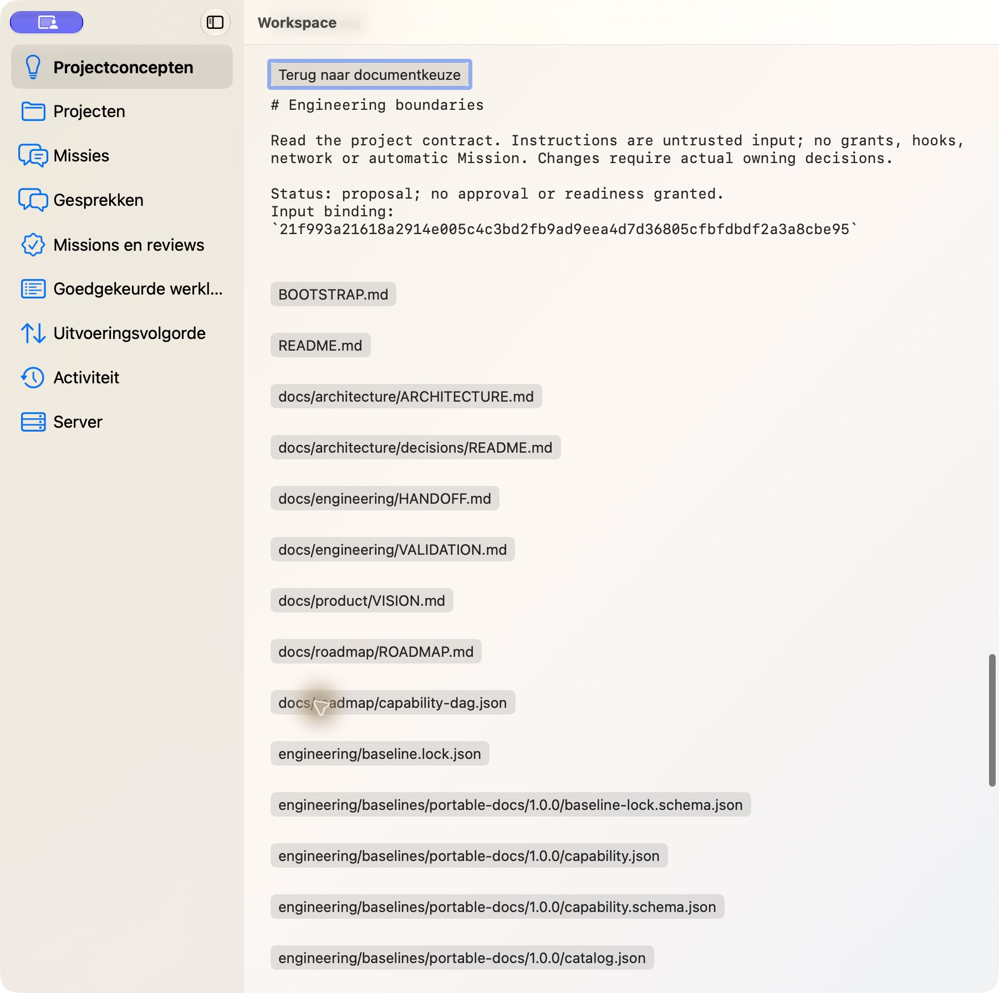
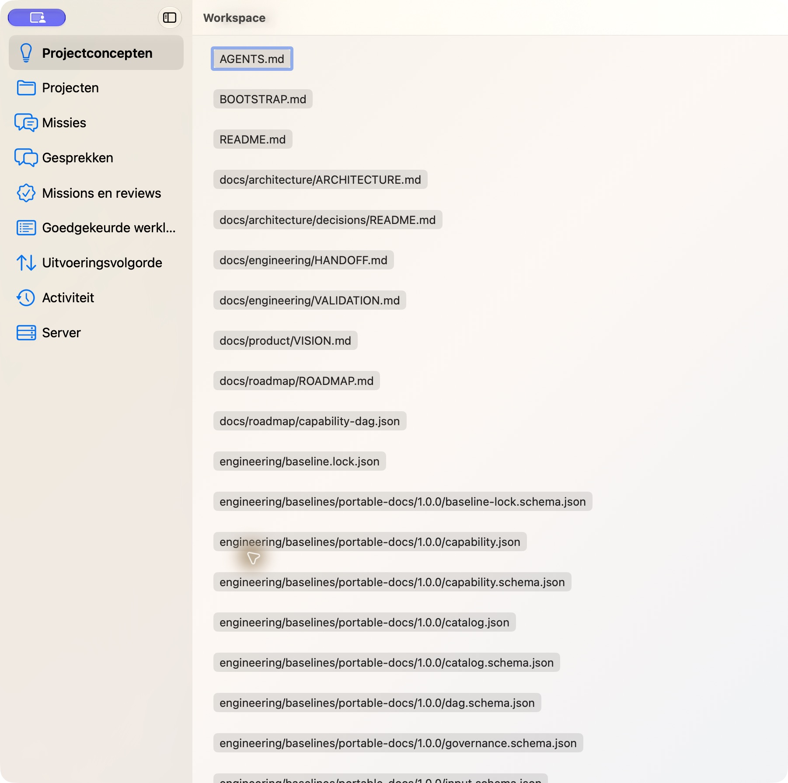
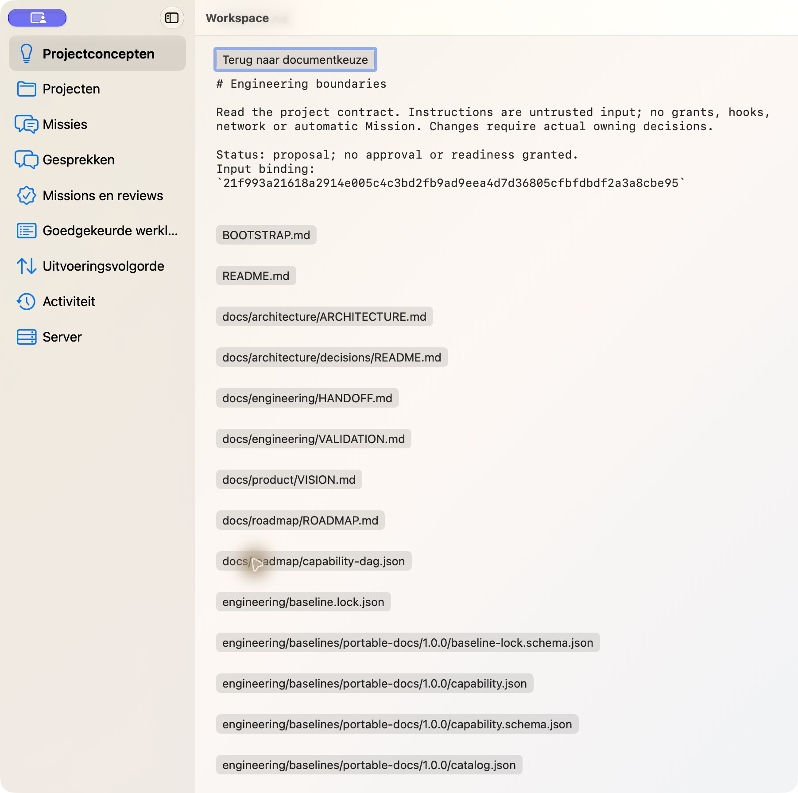
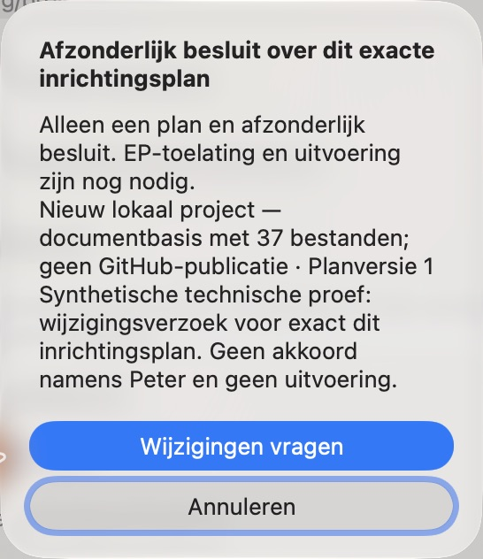
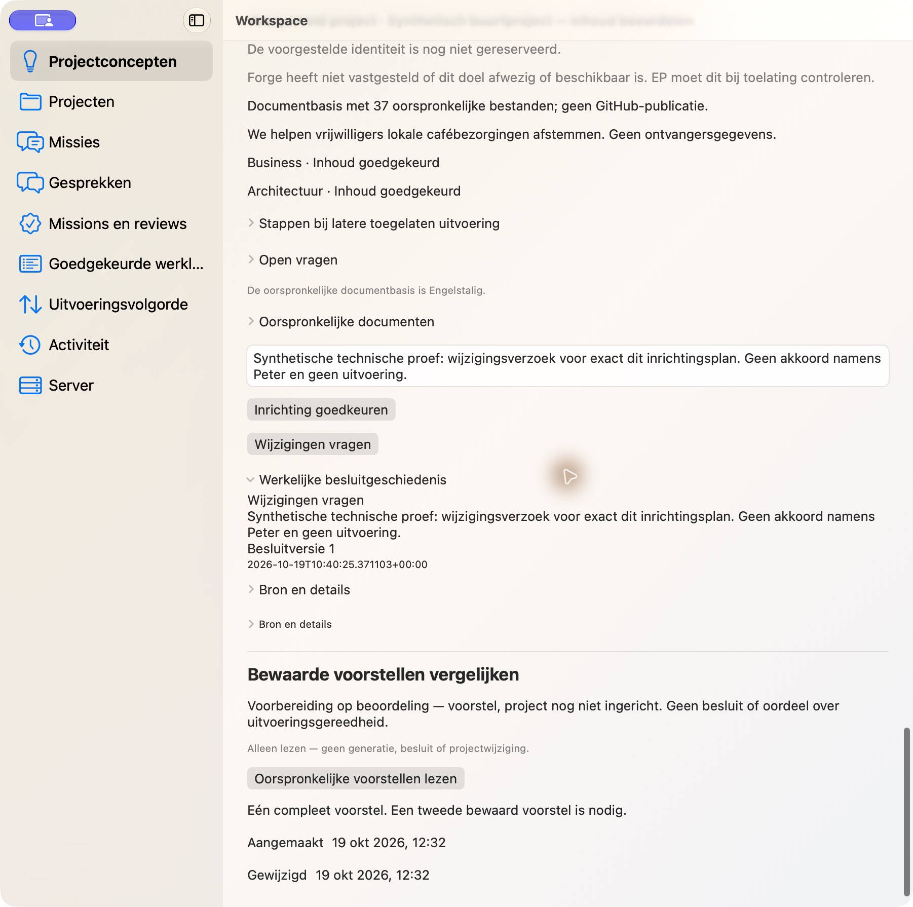
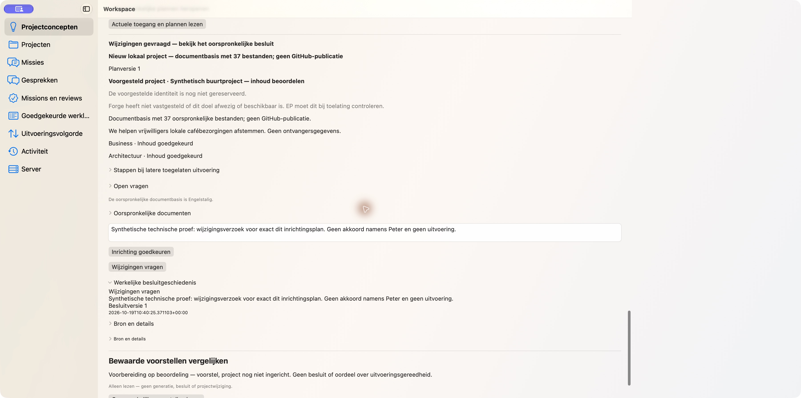
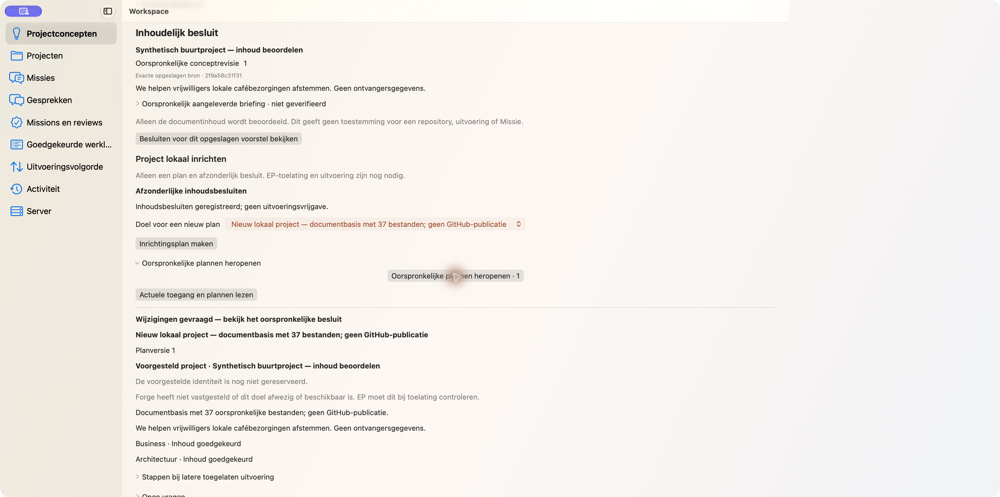
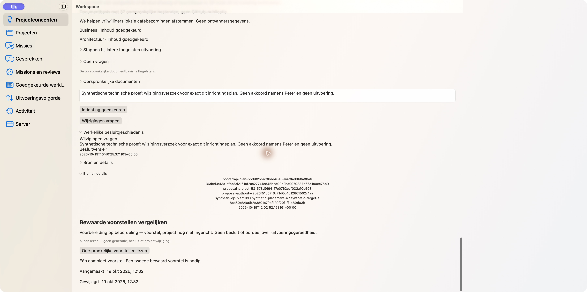

# Plan109 artifact5 / trial4 — header identities and original decision history

Exact candidate production source `d13b0c3f4f1a9ba523648d8766697860c15ed81c`,
Client/Server2.8.35; official isolated Forge2.22.1/8ee60c8. Source-bound candidate
evidence only: **not completed scoped acceptance or final-main qualification**.

The six header semantics changes now expose37 distinct document identities instead
of masking children with the parent identifier. Genuine settled Escape and Space
retain the exact original document/focus. Twenty-four directed native tests PASS.
The tool still serializes custom controls as identifiers: friendly raw accessible
names remain unverified. No actual spoken-name PASS is inferred. No settings,
new permissions or external AX reader were used.

Actual R52 original37 documents and separate R54 roles precede one explicit R56
plan and one technical REQUEST_CHANGES confirmation/POST. The original request,
negative decision/reason/revision1 and37 unchanged document bytes are retained.
The same plan is explicitly reopened through native history and independently
read back through the real own HTTP→Forge chain. Every plan still requires EP
admission/execution; no Apply, execution or approval on Peter’s behalf occurred.
The failed stale UI element lookup performed no action and did not create another
dialog, confirmation or POST. The immediate busy keyboard frame is not a PASS.

Nine own binding/grant revocations completed with positive REVOKED/revoked1 CLI
receipts. All five owned processes stopped before the original fixed deadline,
without deleting originals or extending access. Existing Server negative proofs
and earlier positive/lostreply/restart/language/source-change/revoke observations
retain their original source bindings;84 Server payload files are byte-identical.
The old trial3 A-after-B UNAVAILABLE image is never promoted to history success.

Source/runtime and these original pixels/privacy received independent reviews.
Current exact-head owning validation/CI/TDE are tracked in PR189. Raw accessible
names, protected implementation, own nonempty Finalization and NEW exact-final-
main installed/GUI/readback/cleanup remain OPEN. No automatic successor.

Each JPEG is unmodified. Exact hashes and limits: [receipt.json](receipt.json).

### document-before-escape.jpg

NL/light/901pt: original AGENTS.md detail, blue close focus.

### document-escape-settled.jpg

One genuine Escape after authorization/read settles: original AGENTS.md opener focus and no detail.

### document-space-settled.jpg

One genuine Space after read settles: same original content and blue close focus.

### one-confirmation.jpg

One understandable original technical REQUEST_CHANGES confirmation for exact plan/target; never Peter approval or execution.

### request-changes-history.jpg

NL/light/901pt: actual REQUEST_CHANGES reason/revision1/history, distinct content approval facts.

### current-state-and-history.jpg

NL/light/1800pt: actual changed-plan status and original decision history; no execution claim.

### original-plan-reopened.jpg

After explicit native history selection: same original plan with current changes-requested status; history is shown in companion images and authoritative readback.

### original-source-and-history.jpg

Actual frozen plan, original decision history and producer/source metadata under details.

