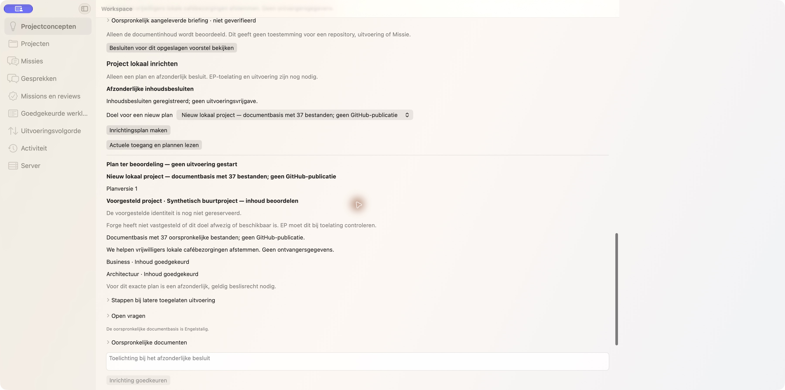
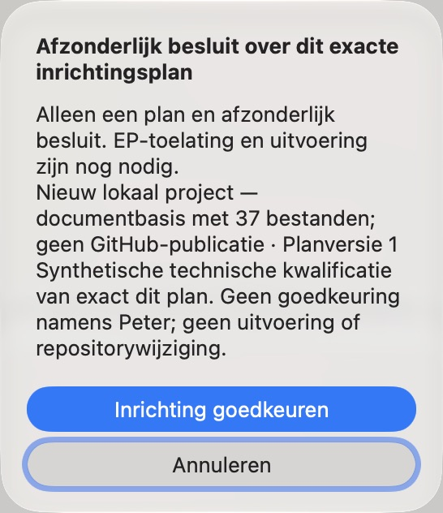
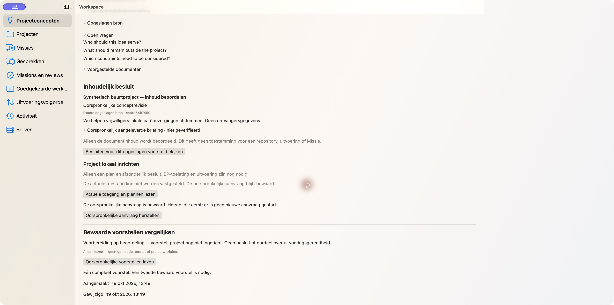
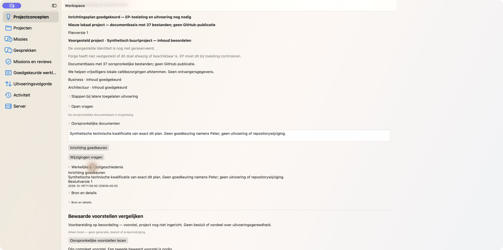
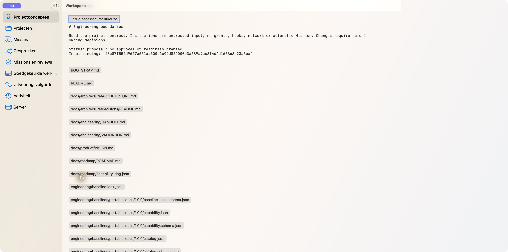

# Plan109 — fresh exact-final-main installed and native GUI evidence

Workspace **2.8.35**, exact protected final main
`c2e7d2aa281b211a70c4e64a2f0ce100f9748538`.
[Implementation PR189](https://github.com/pcvantol/workspace/pull/189) and
[separate nonempty Finalization PR190](https://github.com/pcvantol/workspace/pull/190)
merged through normal protected exact-head delivery. This separate evidence-only
commit preserves that main target; it is not the installed product source.

A fresh native Client and noneditable Workspace Server were built from that
exact main and exercised through real authenticated HTTP to the isolated official
Forge2.22.1/8ee60c8409b2c3801e70cf129f20f1ff1480d03b. All84 installed Workspace
payload files match source/wheel, and independently checked346 Forge payload
files match the official producer wheel. Actual native Mach-O minimum/SDK are
26.0/26.0; the separate available-SDK query is27.0, not the build SDK.

Actual separate R54 content roles precede one R56 immutable37-document plan and
one genuine native technical effect confirmation. The complete157166-byte
success was committed once, deliberately lost downstream, and recovered through
original GETs after separate Client, Workspace Server and Forge OS restarts.
All five readback phases preserve the same operation, request digest, plan,
document bytes and APPROVE_EFFECT revision1. No POST replay or duplicate effect.
The GUI actually shows the pending original, restored decision/reason/history,
explicit same-plan reopen and original AGENTS.md detail/focus. EP admission and
execution are still needed. This synthetic test is not approval on Peter’s behalf.

All9 temporary own binding/grant revocations and5 own process stops completed
before the original fixed deadline; remaining process map is empty. Originals,
partial responses and failed attempts are retained. No access extension, global
upgrade, settings/credentials/signing change or Apply/EP/target/Git/model/scan/
Mission effect. No automatic next feature.

Full7 and own Finalization full8 passed388 native plus1 isolated test, strict
per-file >80.2% coverage, package/noneditable install and native build. Both own
delivery heads passed all5 CI checks and independent Quality/Security/UX.
Actual own TDE6 is QUALIFIED/PASS_WITH_WARNINGS: original exits1/1, maximum28
against15; all99 findings remain OPEN, unchanged and unsuppressed. It is not a
claim that TDE supplied the separate owning runtime coverage.

The wider candidate matrix keeps its original source bindings and unchanged-code
parity. No redundant full matrix, VoiceOver-speech or pixel-offset claim. Old
GUI503 remains inconclusive; restored-fault RED→GREEN remains source-only.
New partial reads remain retained failures followed by successful original GETs.

All five unmodified screenshots were personally privacy-reviewed by independent
Security and UX. Exact digests and scope: [receipt.json](receipt.json). Final
independent cleanup and immutable Git Blob byte readback are recorded in the
terminal lane register after publication, not anticipated here.

## plan-before-effect.jpg

Original immutable plan before separate effect decision; target remains unobserved and unreserved.

## one-confirmation.jpg

One genuine native confirmation, explicitly synthetic technical qualification, not approval on Peter’s behalf or execution.

## original-response-pending.jpg

Original request retained after lost reply; unavailable/unknown phase, never a false approval.

## recovered-approved-history.jpg

After all three separate process restarts: original approved plan and actual decision revision1/reason; EP admission and execution still required.

## original-plan-reopened-document.jpg

Same original plan explicitly reopened through native history; original AGENTS.md readable with focused, named return control.

