# Static onboarding wireframes

**DESIGN_ONLY.** These SVGs/gallery are designed screens, not screenshots or implemented onboarding.
Synthetic Atlas names do not identify a real project. Canvas pixels describe this drawing, not a measured product window.
See [the coherent design](../PROJECT_ONBOARDING_HOLISTIC_V1.md#ux) and [gallery](index.html).

## Screen inventory

| ID | View | Artifact |
| --- | --- | --- |
| 01-overview | Project toevoegen · light | [01-overview.svg](01-overview.svg) |
| 02-new | Nieuw project · light | [02-new.svg](02-new.svg) |
| 03-link | Project koppelen · dark | [03-link.svg](03-link.svg) |
| 04-adopt | Code adopteren · light | [04-adopt.svg](04-adopt.svg) |
| 05-repositories | Bronnen bevestigen · dark | [05-repositories.svg](05-repositories.svg) |
| 06-analysis | Analysevoortgang · light | [06-analysis.svg](06-analysis.svg) |
| 06a-analysis-plan | Analyseplan · dark | [06a-analysis-plan.svg](06a-analysis-plan.svg) |
| 07-finding | Bevinding bespreken · dark | [07-finding.svg](07-finding.svg) |
| 08-approval | Inrichtingsvoorstel · light | [08-approval.svg](08-approval.svg) |
| 09-add-repository | Repository toevoegen · dark | [09-add-repository.svg](09-add-repository.svg) |
| 10-narrow | Bronnen en gesprek · light | [10-narrow.svg](10-narrow.svg) |

## Locale copy and expansion

| Decision / label | en | nl | de | fr | es |
| --- | --- | --- | --- | --- | --- |
| New | New project | Nieuw project | Neues Projekt | Nouveau projet | Nuevo proyecto |
| Link | Link project | Project koppelen | Projekt verbinden | Associer un projet | Vincular proyecto |
| Adopt | Adopt code | Code adopteren | Code übernehmen | Adopter le code | Adoptar código |
| Sources | Confirm sources | Bronnen bevestigen | Quellen bestätigen | Confirmer les sources | Confirmar fuentes |
| Analysis consent | Start scoped analysis | Start begrensde analyse | Begrenzte Analyse starten | Lancer l’analyse limitée | Iniciar análisis limitado |
| Discuss | Discuss findings | Bevindingen bespreken | Befunde besprechen | Discuter des constats | Comentar hallazgos |
| Exact effect | Confirm this setup | Deze inrichting bevestigen | Diese Einrichtung bestätigen | Confirmer cette configuration | Confirmar esta configuración |
| Child | Add repository | Repository toevoegen | Repository hinzufügen | Ajouter un dépôt | Añadir repositorio |
| Publication | Review history publication | Publicatie van historie bekijken | Veröffentlichung der Historie prüfen | Examiner la publication de l’historique | Revisar publicación del historial |
| Denied | Access unavailable | Toegang ontbreekt | Zugriff fehlt | Accès indisponible | Acceso no disponible |
| Partial | Partially assessed | Partieel beoordeeld | Teilweise bewertet | Évaluation partielle | Evaluación parcial |
| Uncertain | Checking original operation | Oorspronkelijke operatie teruglezen | Ursprünglichen Vorgang prüfen | Vérification de l’opération initiale | Comprobando operación original |

Human labels are proposed copy; identifiers/contracts stay unchanged. Allow ≥40% expansion, wrapped
buttons and 200% text. The narrow drawing is a 640px composition; smaller windows stack further.
Light/dark drawings illustrate contrast and system appearance; materials/glass are proposed native
chrome only. Color never carries status alone. Screen reading order is in SVG title/description and
manifest; focus rules and VoiceOver announcements are normative design requirements, not tested UI claims.

## Navigation and states

Overview→new/link/adopt; each journey uses Sources and optional Chat. Basic link returns to project
without analysis/setup. Adopt→analysis→findings→exact preview→owning progress. Add child starts from
the current project and reuses scoped Sources/Preview, never New project. The diagrams in the main
design define uncertainty/recovery transitions. Gallery links only navigate drawings; depicted actions
are not connected to any service. No JavaScript, provider calls, grants or application toolchain.

## Complete rendered static previews and text alternatives

SVG/PNG hashes and rendered dimensions are bound in the manifest. Temporary padding preserves
the full original design canvas. Drawings are not product screenshots. Current story: one selected
repository atlas-core, two documents; atlas-client excluded/unassessed through source, plan and progress.

### Project toevoegen

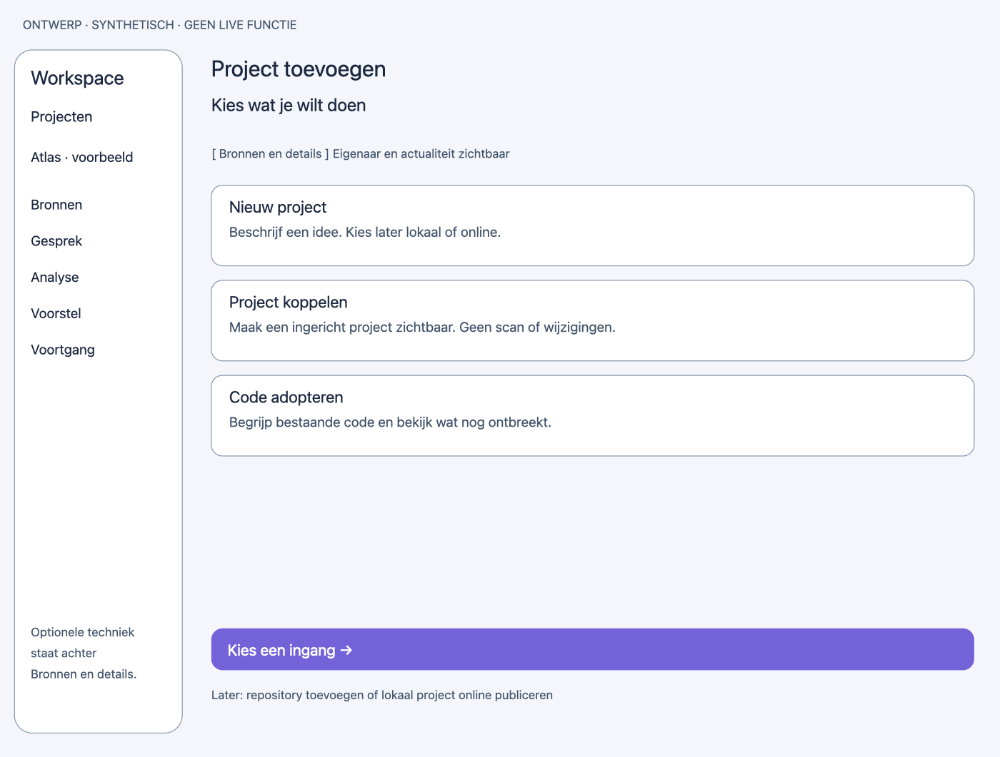

- ONTWERP · SYNTHETISCH · GEEN LIVE FUNCTIE
- Workspace
- Projecten
- Atlas · voorbeeld
- Bronnen
- Gesprek
- Analyse
- Voorstel
- Voortgang
- Optionele techniek
- staat achter
- Bronnen en details.
- Project toevoegen
- Kies wat je wilt doen
- [ Bronnen en details ]     Eigenaar en actualiteit zichtbaar
- Nieuw project
- Beschrijf een idee. Kies later lokaal of online.
- Project koppelen
- Maak een ingericht project zichtbaar. Geen scan of wijzigingen.
- Code adopteren
- Begrijp bestaande code en bekijk wat nog ontbreekt.
- Kies een ingang →
- Later: repository toevoegen of lokaal project online publiceren

### Nieuw project

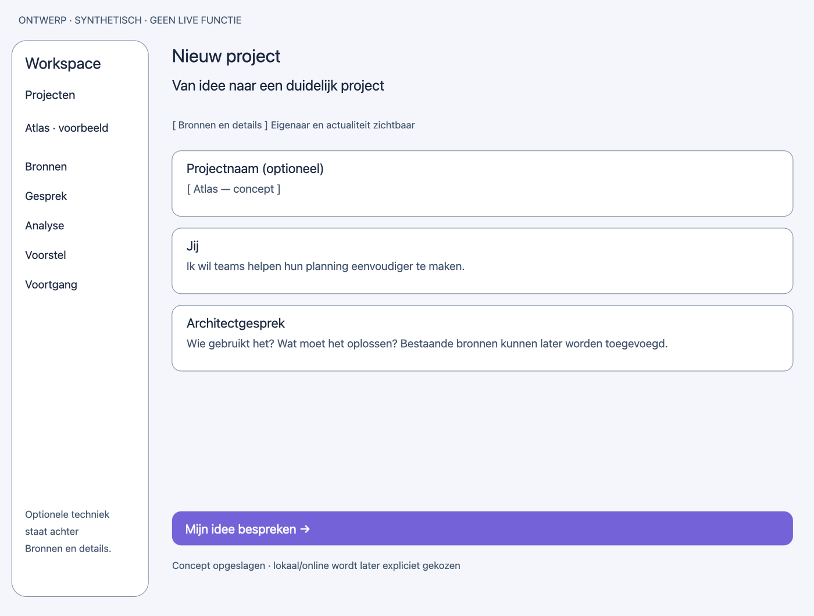

- ONTWERP · SYNTHETISCH · GEEN LIVE FUNCTIE
- Workspace
- Projecten
- Atlas · voorbeeld
- Bronnen
- Gesprek
- Analyse
- Voorstel
- Voortgang
- Optionele techniek
- staat achter
- Bronnen en details.
- Nieuw project
- Van idee naar een duidelijk project
- [ Bronnen en details ]     Eigenaar en actualiteit zichtbaar
- Projectnaam (optioneel)
- [ Atlas — concept ]
- Jij
- Ik wil teams helpen hun planning eenvoudiger te maken.
- Architectgesprek
- Wie gebruikt het? Wat moet het oplossen? Bestaande bronnen kunnen later worden toegevoegd.
- Mijn idee bespreken →
- Concept opgeslagen · lokaal/online wordt later expliciet gekozen

### Project koppelen

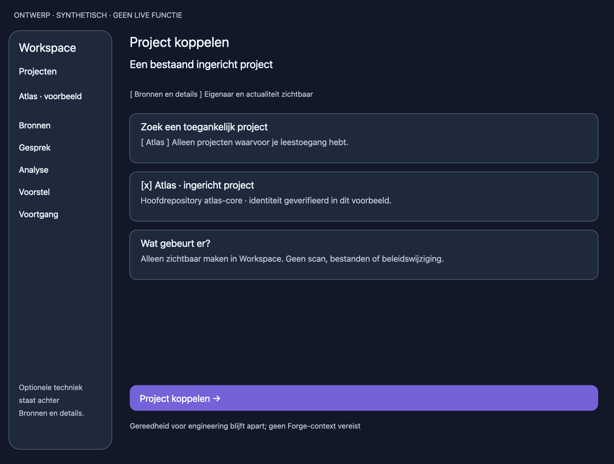

- ONTWERP · SYNTHETISCH · GEEN LIVE FUNCTIE
- Workspace
- Projecten
- Atlas · voorbeeld
- Bronnen
- Gesprek
- Analyse
- Voorstel
- Voortgang
- Optionele techniek
- staat achter
- Bronnen en details.
- Project koppelen
- Een bestaand ingericht project
- [ Bronnen en details ]     Eigenaar en actualiteit zichtbaar
- Zoek een toegankelijk project
- [ Atlas ] Alleen projecten waarvoor je leestoegang hebt.
- [x] Atlas · ingericht project
- Hoofdrepository atlas-core · identiteit geverifieerd in dit voorbeeld.
- Wat gebeurt er?
- Alleen zichtbaar maken in Workspace. Geen scan, bestanden of beleidswijziging.
- Project koppelen →
- Gereedheid voor engineering blijft apart; geen Forge-context vereist

### Code adopteren

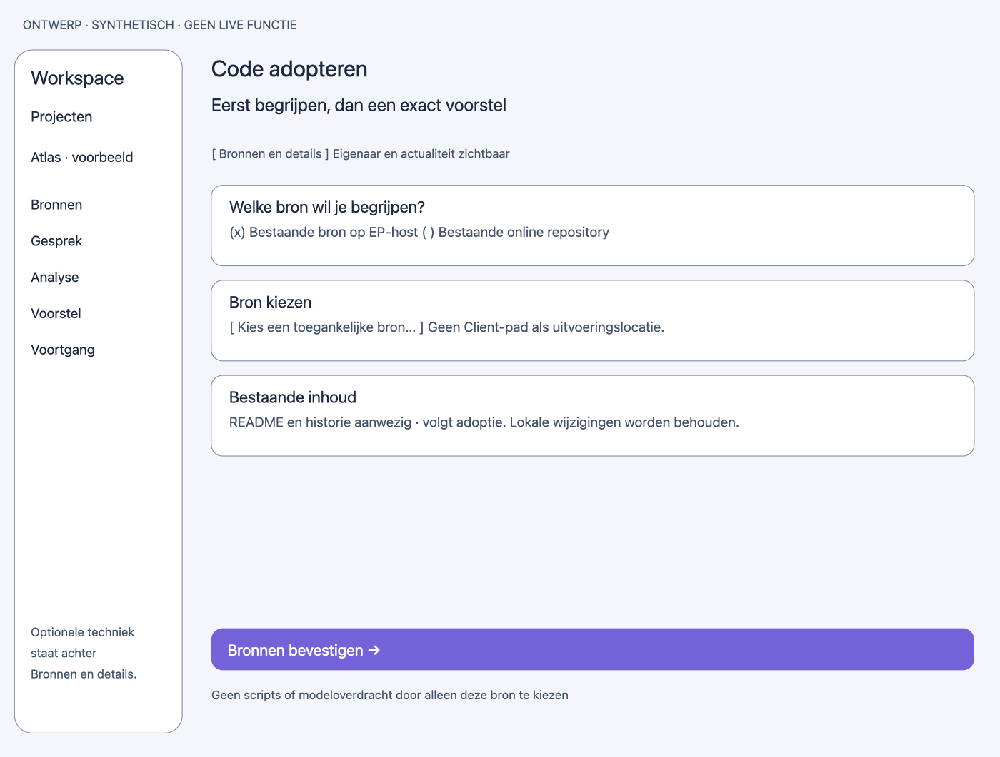

- ONTWERP · SYNTHETISCH · GEEN LIVE FUNCTIE
- Workspace
- Projecten
- Atlas · voorbeeld
- Bronnen
- Gesprek
- Analyse
- Voorstel
- Voortgang
- Optionele techniek
- staat achter
- Bronnen en details.
- Code adopteren
- Eerst begrijpen, dan een exact voorstel
- [ Bronnen en details ]     Eigenaar en actualiteit zichtbaar
- Welke bron wil je begrijpen?
- (x) Bestaande bron op EP-host ( ) Bestaande online repository
- Bron kiezen
- [ Kies een toegankelijke bron… ] Geen Client-pad als uitvoeringslocatie.
- Bestaande inhoud
- README en historie aanwezig · volgt adoptie. Lokale wijzigingen worden behouden.
- Bronnen bevestigen →
- Geen scripts of modeloverdracht door alleen deze bron te kiezen

### Bronnen bevestigen

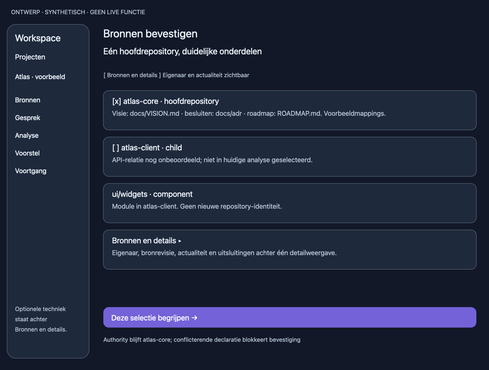

- ONTWERP · SYNTHETISCH · GEEN LIVE FUNCTIE
- Workspace
- Projecten
- Atlas · voorbeeld
- Bronnen
- Gesprek
- Analyse
- Voorstel
- Voortgang
- Optionele techniek
- staat achter
- Bronnen en details.
- Bronnen bevestigen
- Eén hoofdrepository, duidelijke onderdelen
- [ Bronnen en details ]     Eigenaar en actualiteit zichtbaar
- [x] atlas-core · hoofdrepository
- Visie: docs/VISION.md · besluiten: docs/adr · roadmap: ROADMAP.md. Voorbeeldmappings.
- [ ] atlas-client · child
- API-relatie nog onbeoordeeld; niet in huidige analyse geselecteerd.
-     ui/widgets · component
- Module in atlas-client. Geen nieuwe repository-identiteit.
- Bronnen en details ▸
- Eigenaar, bronrevisie, actualiteit en uitsluitingen achter één detailweergave.
- Deze selectie begrijpen →
- Authority blijft atlas-core; conflicterende declaratie blokkeert bevestiging

### Analysevoortgang

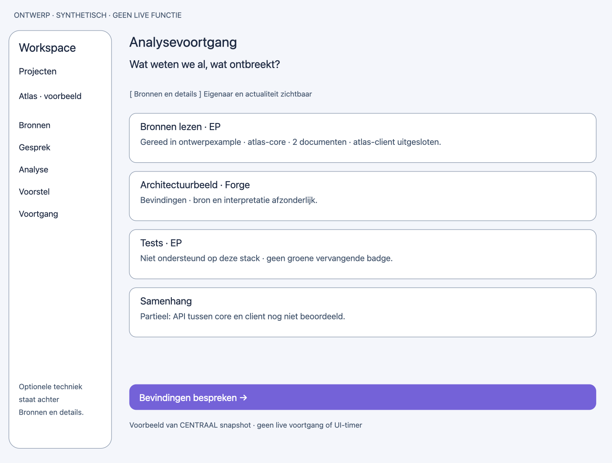

- ONTWERP · SYNTHETISCH · GEEN LIVE FUNCTIE
- Workspace
- Projecten
- Atlas · voorbeeld
- Bronnen
- Gesprek
- Analyse
- Voorstel
- Voortgang
- Optionele techniek
- staat achter
- Bronnen en details.
- Analysevoortgang
- Wat weten we al, wat ontbreekt?
- [ Bronnen en details ]     Eigenaar en actualiteit zichtbaar
- Bronnen lezen · EP
- Gereed in ontwerpexample · atlas-core · 2 documenten · atlas-client uitgesloten.
- Architectuurbeeld · Forge
- Bevindingen · bron en interpretatie afzonderlijk.
- Tests · EP
- Niet ondersteund op deze stack · geen groene vervangende badge.
- Samenhang
- Partieel: API tussen core en client nog niet beoordeeld.
- Bevindingen bespreken →
- Voorbeeld van CENTRAAL snapshot · geen live voortgang of UI-timer

### Analyseplan

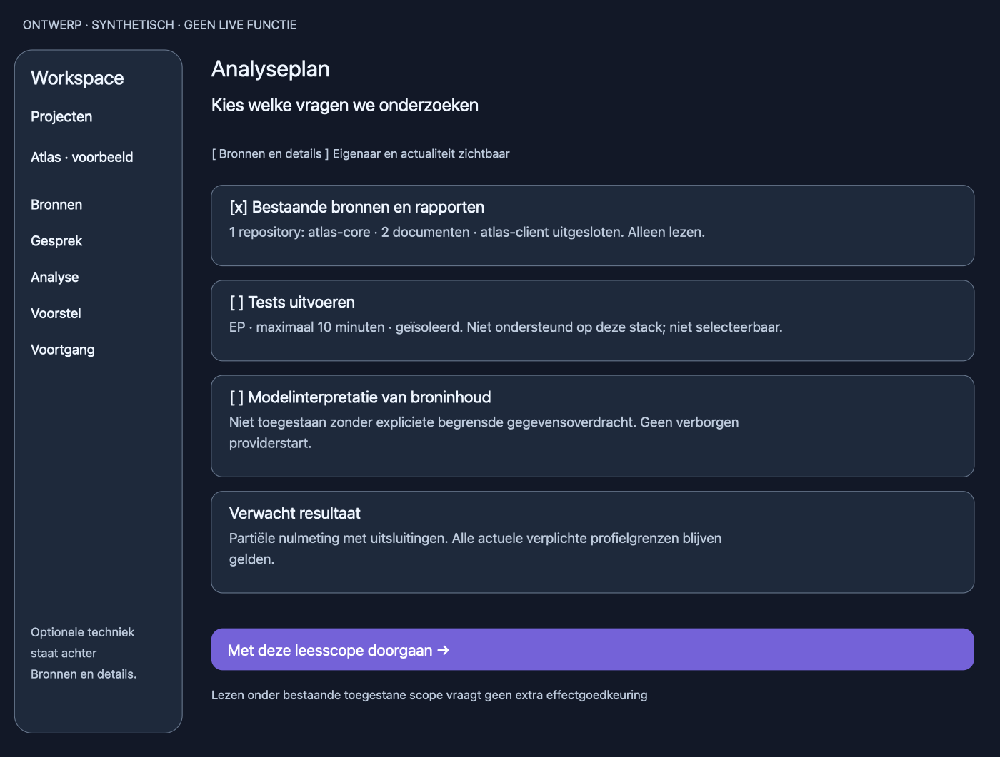

- ONTWERP · SYNTHETISCH · GEEN LIVE FUNCTIE
- Workspace
- Projecten
- Atlas · voorbeeld
- Bronnen
- Gesprek
- Analyse
- Voorstel
- Voortgang
- Optionele techniek
- staat achter
- Bronnen en details.
- Analyseplan
- Kies welke vragen we onderzoeken
- [ Bronnen en details ]     Eigenaar en actualiteit zichtbaar
- [x] Bestaande bronnen en rapporten
- 1 repository: atlas-core · 2 documenten · atlas-client uitgesloten. Alleen lezen.
- [ ] Tests uitvoeren
- EP · maximaal 10 minuten · geïsoleerd. Niet ondersteund op deze stack; niet selecteerbaar.
- [ ] Modelinterpretatie van broninhoud
- Niet toegestaan zonder expliciete begrensde gegevensoverdracht. Geen verborgen
- providerstart.
- Verwacht resultaat
- Partiële nulmeting met uitsluitingen. Alle actuele verplichte profielgrenzen blijven
- gelden.
- Met deze leesscope doorgaan →
- Lezen onder bestaande toegestane scope vraagt geen extra effectgoedkeuring

### Bevinding bespreken

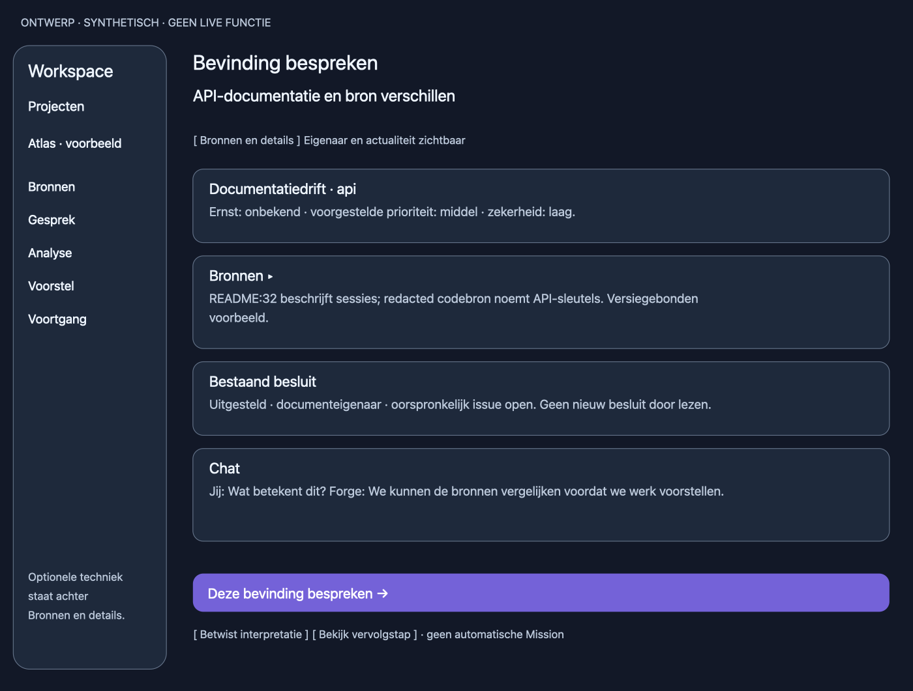

- ONTWERP · SYNTHETISCH · GEEN LIVE FUNCTIE
- Workspace
- Projecten
- Atlas · voorbeeld
- Bronnen
- Gesprek
- Analyse
- Voorstel
- Voortgang
- Optionele techniek
- staat achter
- Bronnen en details.
- Bevinding bespreken
- API-documentatie en bron verschillen
- [ Bronnen en details ]     Eigenaar en actualiteit zichtbaar
- Documentatiedrift · api
- Ernst: onbekend · voorgestelde prioriteit: middel · zekerheid: laag.
- Bronnen ▸
- README:32 beschrijft sessies; redacted codebron noemt API-sleutels. Versiegebonden
- voorbeeld.
- Bestaand besluit
- Uitgesteld · documenteigenaar · oorspronkelijk issue open. Geen nieuw besluit door lezen.
- Chat
- Jij: Wat betekent dit? Forge: We kunnen de bronnen vergelijken voordat we werk voorstellen.
- Deze bevinding bespreken →
- [ Betwist interpretatie ] [ Bekijk vervolgstap ] · geen automatische Mission

### Inrichtingsvoorstel

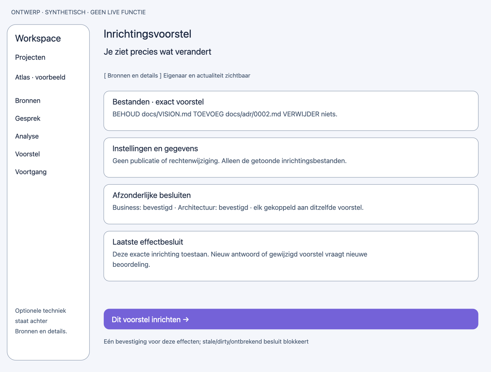

- ONTWERP · SYNTHETISCH · GEEN LIVE FUNCTIE
- Workspace
- Projecten
- Atlas · voorbeeld
- Bronnen
- Gesprek
- Analyse
- Voorstel
- Voortgang
- Optionele techniek
- staat achter
- Bronnen en details.
- Inrichtingsvoorstel
- Je ziet precies wat verandert
- [ Bronnen en details ]     Eigenaar en actualiteit zichtbaar
- Bestanden · exact voorstel
- BEHOUD docs/VISION.md TOEVOEG docs/adr/0002.md VERWIJDER niets.
- Instellingen en gegevens
- Geen publicatie of rechtenwijziging. Alleen de getoonde inrichtingsbestanden.
- Afzonderlijke besluiten
- Business: bevestigd · Architectuur: bevestigd · elk gekoppeld aan ditzelfde voorstel.
- Laatste effectbesluit
- Deze exacte inrichting toestaan. Nieuw antwoord of gewijzigd voorstel vraagt nieuwe
- beoordeling.
- Dit voorstel inrichten →
- Eén bevestiging voor deze effecten; stale/dirty/ontbrekend besluit blokkeert

### Repository toevoegen

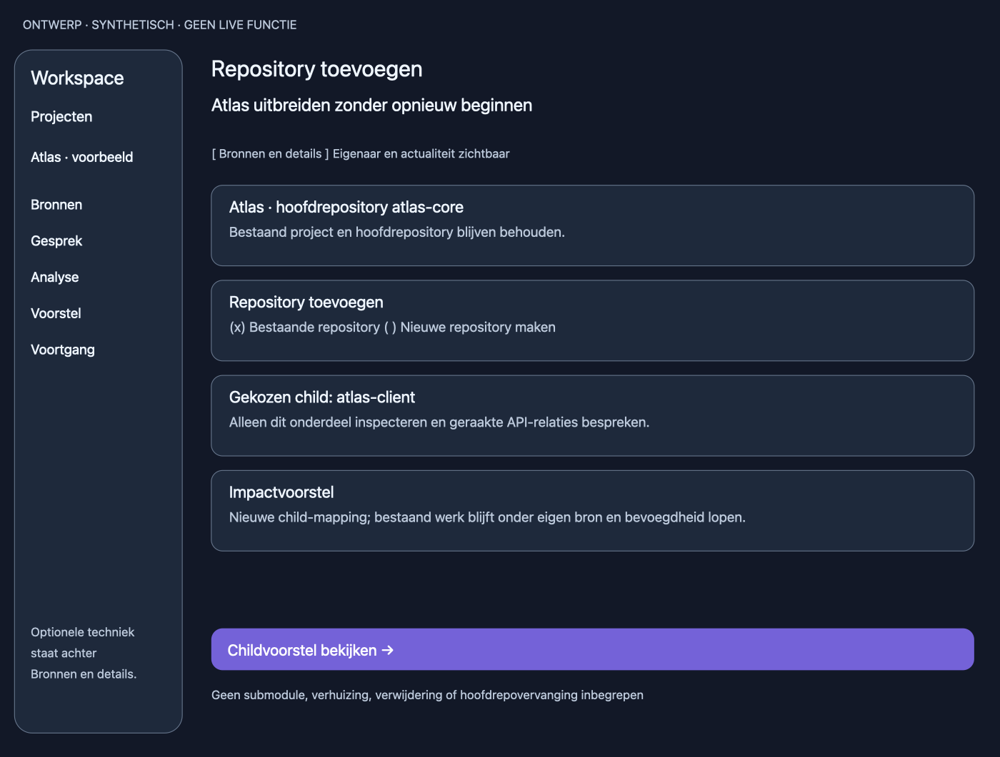

- ONTWERP · SYNTHETISCH · GEEN LIVE FUNCTIE
- Workspace
- Projecten
- Atlas · voorbeeld
- Bronnen
- Gesprek
- Analyse
- Voorstel
- Voortgang
- Optionele techniek
- staat achter
- Bronnen en details.
- Repository toevoegen
- Atlas uitbreiden zonder opnieuw beginnen
- [ Bronnen en details ]     Eigenaar en actualiteit zichtbaar
- Atlas · hoofdrepository atlas-core
- Bestaand project en hoofdrepository blijven behouden.
- Repository toevoegen
- (x) Bestaande repository ( ) Nieuwe repository maken
- Gekozen child: atlas-client
- Alleen dit onderdeel inspecteren en geraakte API-relaties bespreken.
- Impactvoorstel
- Nieuwe child-mapping; bestaand werk blijft onder eigen bron en bevoegdheid lopen.
- Childvoorstel bekijken →
- Geen submodule, verhuizing, verwijdering of hoofdrepovervanging inbegrepen

### Bronnen en gesprek

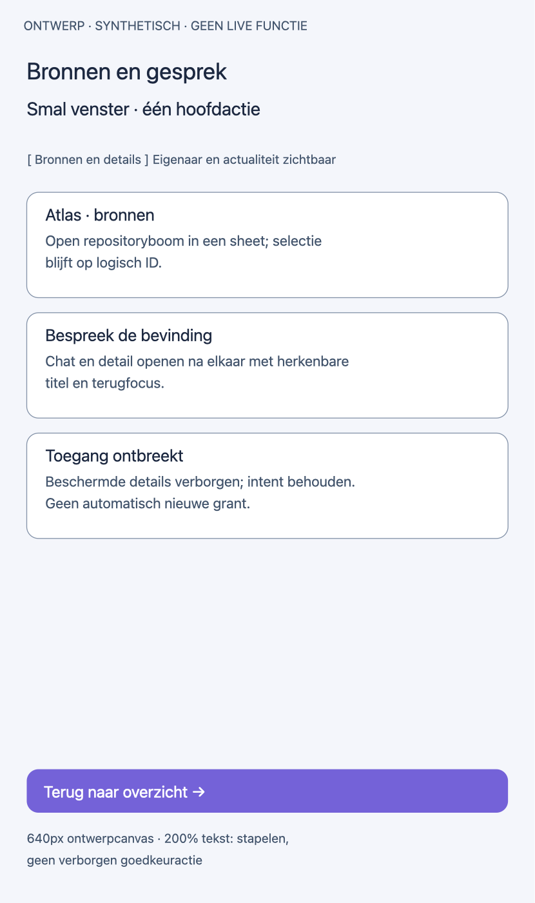

- ONTWERP · SYNTHETISCH · GEEN LIVE FUNCTIE
- Bronnen en gesprek
- Smal venster · één hoofdactie
- [ Bronnen en details ]     Eigenaar en actualiteit zichtbaar
- Atlas · bronnen
- Open repositoryboom in een sheet; selectie
- blijft op logisch ID.
- Bespreek de bevinding
- Chat en detail openen na elkaar met herkenbare
- titel en terugfocus.
- Toegang ontbreekt
- Beschermde details verborgen; intent behouden.
- Geen automatisch nieuwe grant.
- Terug naar overzicht →
- 640px ontwerpcanvas · 200% tekst: stapelen,
- geen verborgen goedkeuractie
