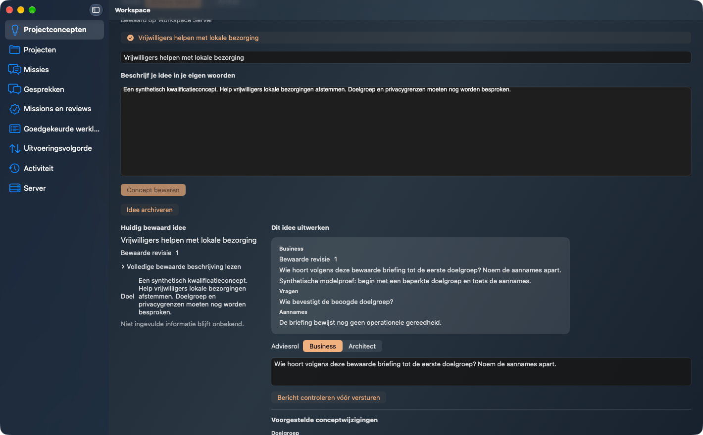
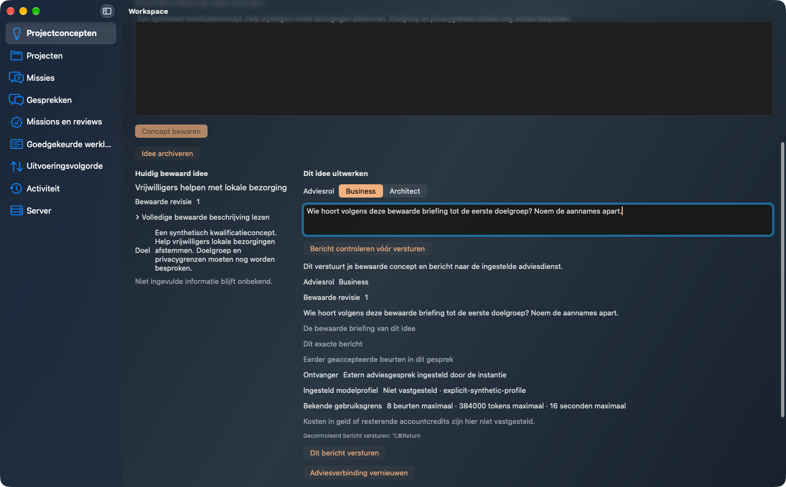
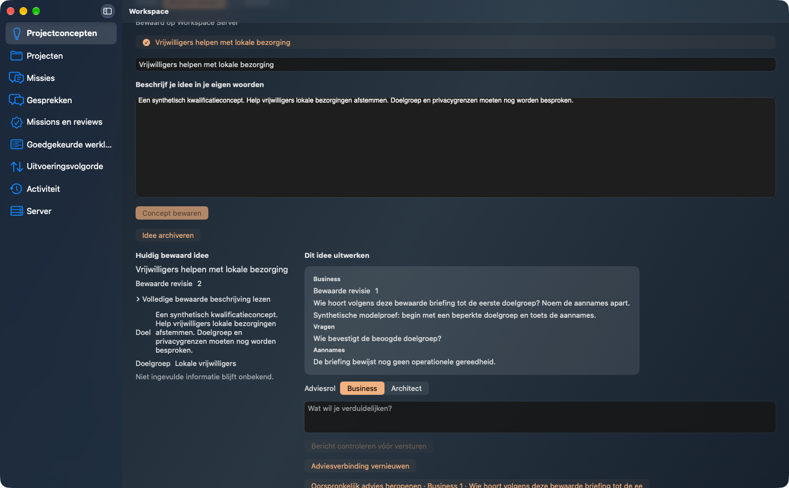

# Plan104 new exact-final-main installed acceptance

Workspace2.8.28 exacte95f8a4362a74cdc4640af3adf9276d28e8210ae, after protected implementation PR171
and own nonempty protected finalization PR176. Fresh own wheel/noneditable Server
and packaged native Client; source/payload/binary independently hash-verified.
Qualified Forge2.19.0/schema46/877602f frozen Mac wheelfca4f936; all325producerpayloads
verified. Original R52 remains2.18.0/96e1d736/wheel20efb7, unchanged319payloads.
Actual Mach-O minimum26.0/SDK26.0. No global installation or system setting changed.

NEW actual native review/send → separate Business answer/proposal → explicit own
adoption1→2 → separate native Basisvoorstel request →37actual R52documents →
actual complete VISION.md opened and text/hash matched, including adopted users.
One explicitly synthetic external executable call, zero paid/live provider calls;
no live advice quality claim, EP/Mission/approval/apply/repository effect.
Own grant/pairings/process/listener cleanup COMPLETE before original fixeddeadline.

Independent read-only Quality/Security/UX accept the exact installed artifacts,
actual GUI/readbacks, source bindings and cleanup. All three original unmodified
screenshots have independent pixelprivacy and Security PNGmetadata approval.
The adopted-briefing image shows that viewport; the expanded VISION is below it
and its complete contents are proven by the actual native AX readback, not by
claiming that its full text is visible in that image.
All5own finalizationhead checks passed. Exactfinalmain automatic CI remains
a separate required gate and is recorded in the terminal register.
Actual TDE QUALIFIED/PASS_WITH_WARNINGS complexity28; own runtimecoverage separate.
Full validation13 PASS294Python/291native+1isolated and strict >80.2%perfile gates.

[Qualified candidate recovery and complete scoped matrix](https://github.com/pcvantol/workspace/tree/6fa9bd15f20b6e48983857a1224467b7972ff527/docs/qualification/plan104-qualified-r53-candidate-20261015)
retains source3936/trial3: Business/followup/Architect, twoadoptions1→2→3,
lost COMPLETE reply, separate Server/Client OS restarts, same original operation
without repeated first effect, oldproposalbytes unchanged and37updateddocuments.
Earlier negative/five-language/theme/narrow/focus evidence keeps its original
source. Relevant runtimecode unchanged; oldimages are never relabelled finalmain.

Cumulative12corrections/4installed/13fullvalidations; oldfailurehistories preserved.
NativeCI38647802499 timer-observation failure retained; C12 only waits bounded2s
for the real autonomous timer, keeps both assertions, changes no productdeadline.
Read-only observer failures remain retained: narrow-only opener wait in the wide
inline layout, review waiting across the post-adoption concept reload, and an
AXButton assumption for the native document disclosure group. The same original
trial/deadline continued without repeated model/adoption/R52 effects.
Evidence covers only the selected concept-chat subset; terminal closure follows
immutable public readback. No automatic next feature.

