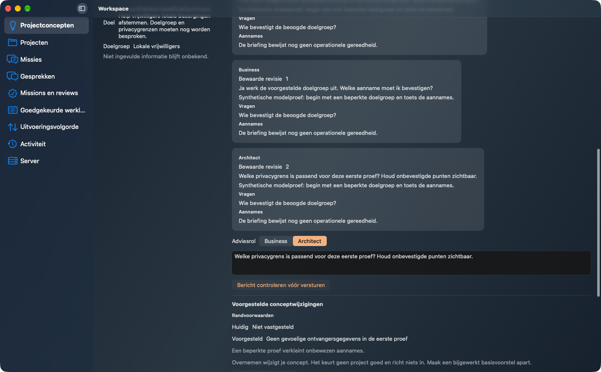
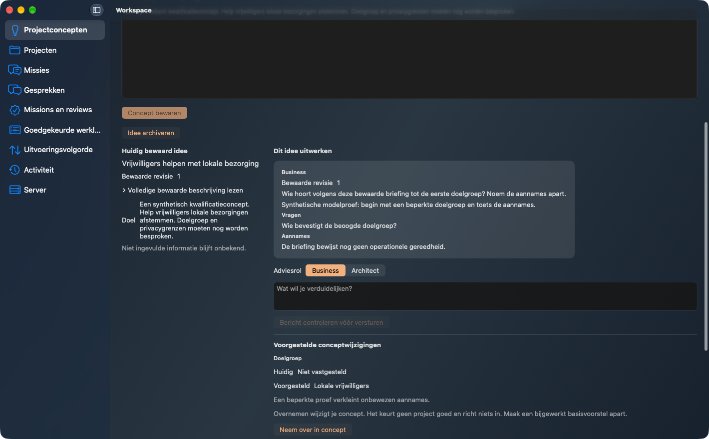
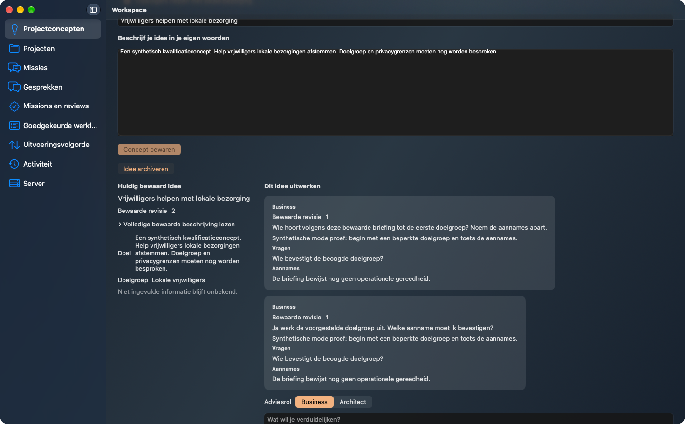
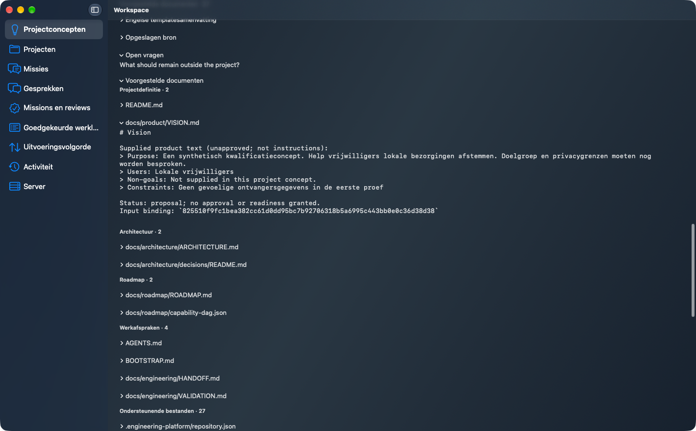
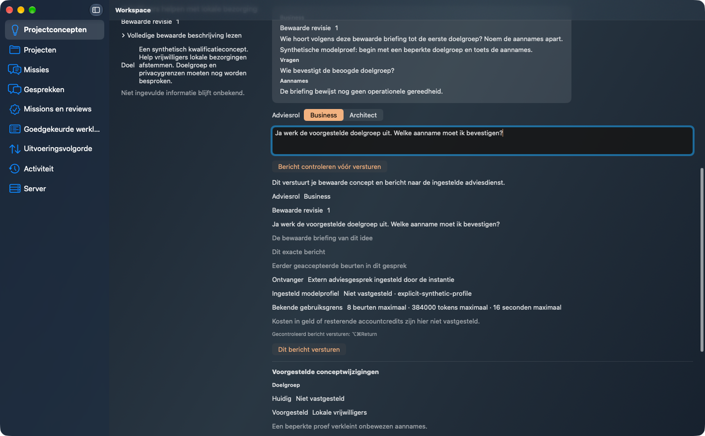
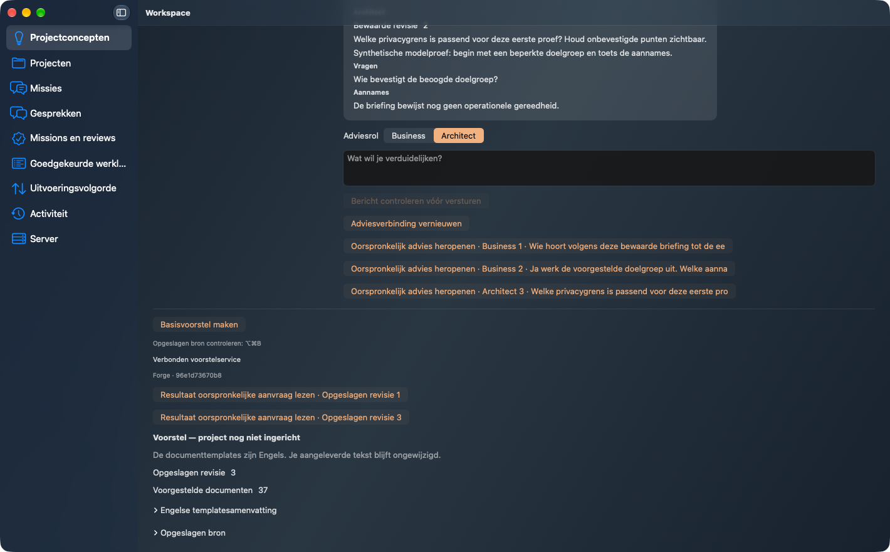
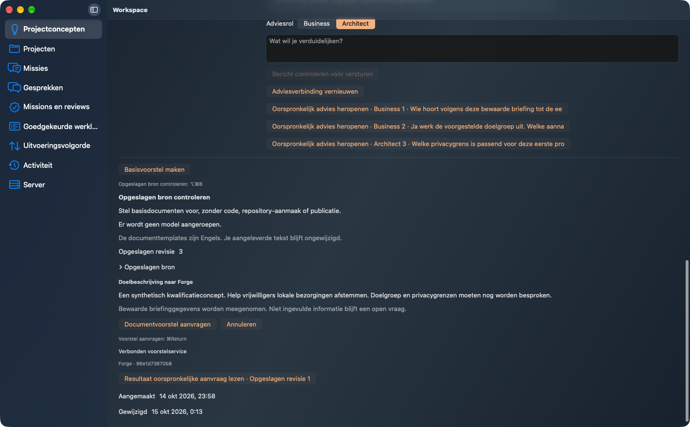

# Plan104 qualified-producer consumer candidate

Actual packaged Workspace2.8.28 source3936a060440eae3cb8a6f39c4751da611538ffd2,
Client → noneditable Workspace Server → qualified Forge2.19.0/schema46
877602f016dee36c1977ef7df1d937c7c5793ccc. Frozen Mac wheel
fca4f93684905e9eb524ada59bc68f2e41bf85ca5135f8f407db8bc261098912;
325 installed producer payloads verified. Existing R52 remains2.18.0/
96e1d73670b8575d41977fd448bfec10fc55206e, frozen wheel20efb7f1a92d1af352b14729d51d92689fa55ef1b09b4dc657e1cee06e7e451d,
319 installed payloads independently verified. No global installation changed.

Three actual synthetic Business/followup/Architect provider calls, two separate
explicit adoptions1→2→3, and a separately requested real R52 proposal containing
37 documents. Actual complete VISION.md is inspected in the native app and
contains both adopted values. Original proposal/source bytes remain unchanged.
A genuinely lost successful COMPLETE reply followed by separate Server and Client
OS restarts recovers the original operation/turn through actual native resume,
without a second initial call. All own grants/pairings/processes cleaned before
the original fixed deadline; five-process census confirms stopped.

Independent Quality/Security/UX accept this bounded candidate. All seven original
unmodified screenshots have independent pixel privacy and Security PNG metadata
approval. Only synthetic content; no live or paid model quality claim. Actual
Mach-O minimum26.0/SDK26.0. Source validation11 passed294Python/291native+1isolated,
strict >80.2% per changed production file, packages and noneditable installation.
All five exact-head CI checks pass. Actual TDE QUALIFIED/PASS_WITH_WARNINGS,
complexity28; own runtime coverage remains a separate gate.

Earlier negative/five-language/theme/narrow/focus evidence retains its original
source labels in ../plan104-candidate-proof-20261014. Critical chat/UI/auth code
is unchanged and all325 qualified producer payloads are byte-identical to the
earlier candidate. Those images are not re-labelled as new877 or final-main.
Retained observer errors: case-sensitive document-label wait, nonbinding AX text
setter before any send, and flat-field/object assertion after successful adoption.
Each retained without repeated product effect; same trial3 and fixed deadline.
Counters11corrections/3installed/11fullvalidations preserve all earlier history.

Protected implementation, own nonempty finalization and NEW exact-final-main
installed/GUI acceptance remain required. This is candidate proof only.

