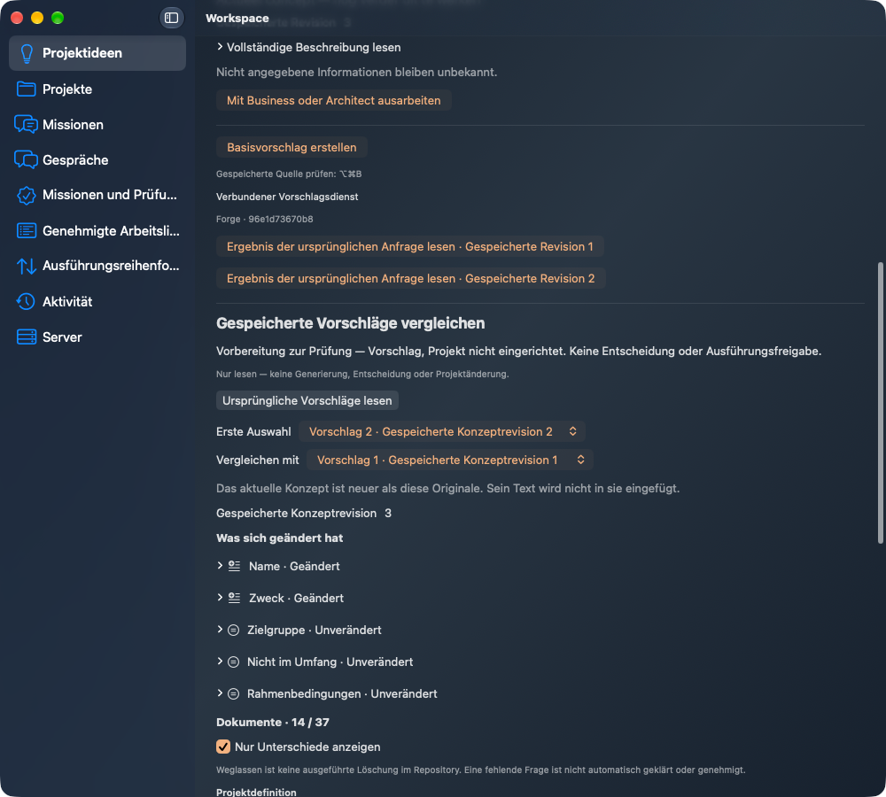
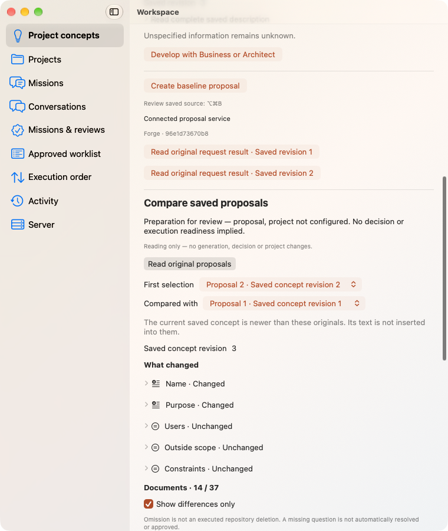
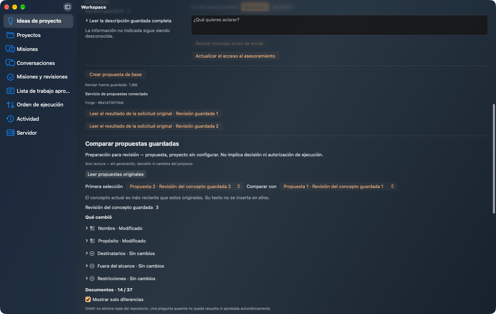
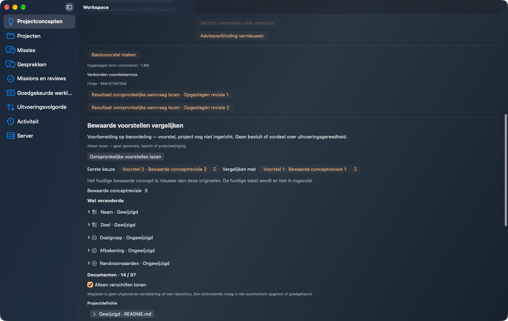
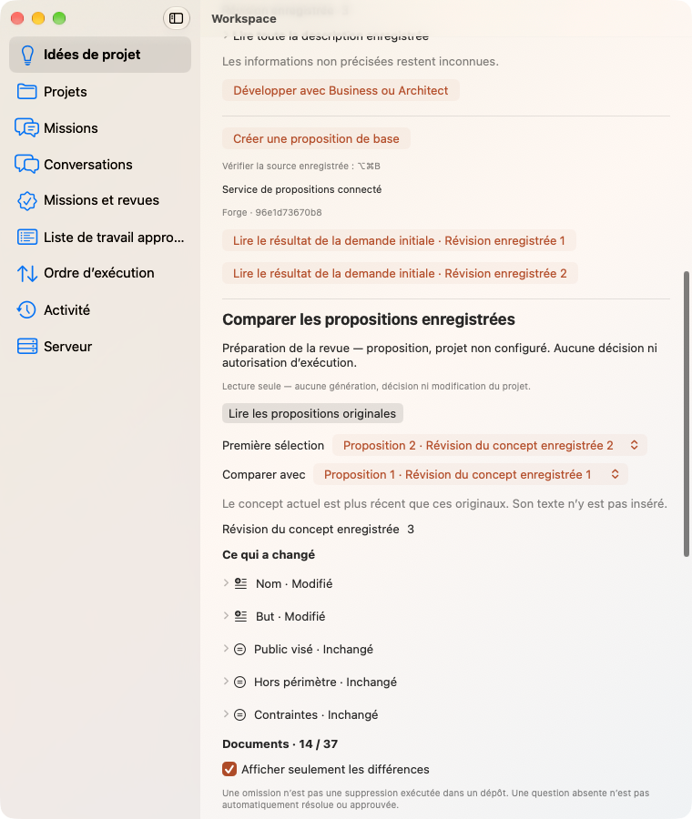
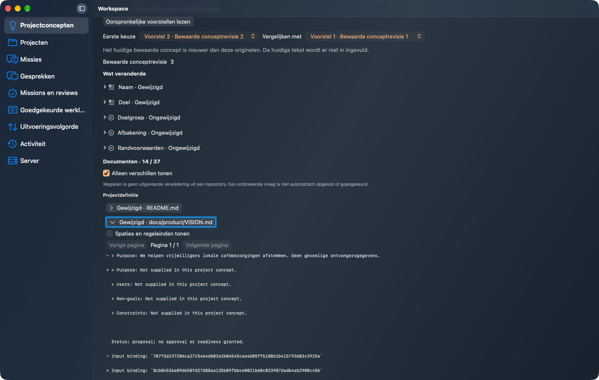
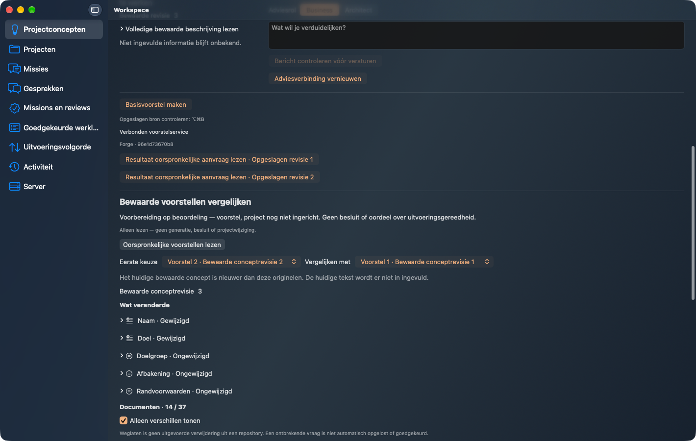
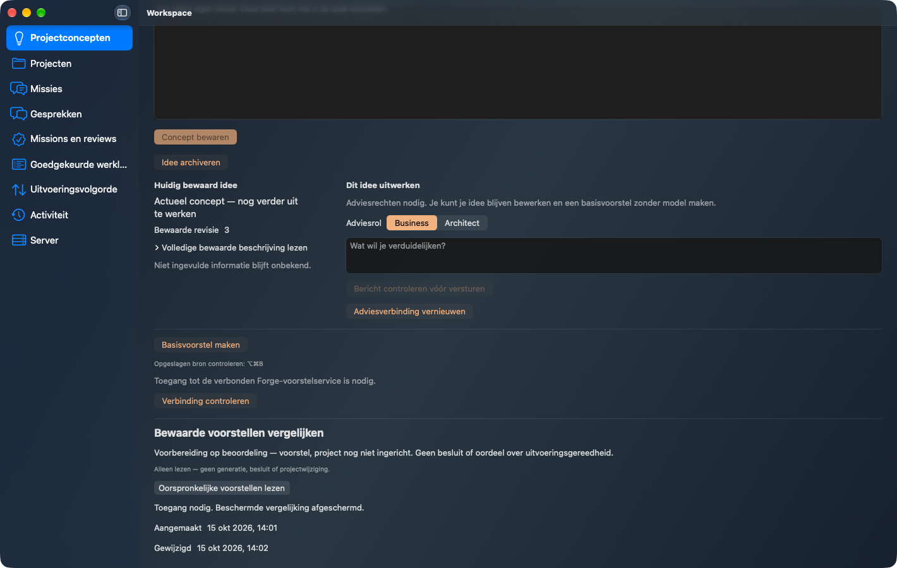
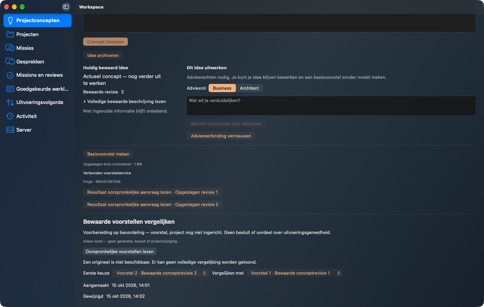

# Plan105 saved proposal comparison — candidate

Exact product source `fed45f260764dfab6e2f8c14dfe84848fd370963`, Workspace2.8.29. Native Client → installed noneditable Workspace Server → qualified Forge2.18.0 R52 originals. Comparison only reads saved originals; no model, preparation, approval or Mission effect. Two separately authorized native preparations create the bounded synthetic fixture before comparison.

Original screenshots below are from the real packaged application, unchanged. English template documents are honestly separate from five-language UI. Read evidence.json for actual source binding, original-byte checks, separate OS restarts, one lost original response, real denial, and cleanup. Previous failures remain recorded under their original sources; no historical image is represented as new final-main proof.

