# Plan106 source-bound candidate observations

Consumer999d9bb, Workspace2.8.30. Qualified Forge2.20.0/0ea1b1a handoff6195333957.
These are candidate observations; protected delivery, own finalization and NEW exact-final-main installed proof remain required.

Preserve individual source labels: ef47 native role/lost-reply/separate-restart/layout observations remain ef47; current999 installed guard checks and actual native read/reverse/chat are separate. Native bytes/packaging are identical across the Server-only round5 guards. Mach-O reports SDK26.0/minimum26.0; the separate available-toolchain query was27.0. Original private manifests retain their earlier SDK_actual label, corrected here without modifying their raw loadcommands. No old source evidence is relabeled as a new final-main test. Qualified source payloads match all331 producer files; own locally built wheel is distinct from the producer's hosted/local wheel.

Business and Architecture were explicitly confirmed separately; history1 stays partial, both records complete document content only. A genuinely failing negative control tests a false both-role expectation, not a permission failure. The real changes-requested/new-proposal/concurrency/capacity observations preserve the failed ninth-command503; installed999 closes that boundary with409/no allocation, and invalid point acknowledgment400/no allocation. READ/late-revoke/expiry cases retain DENIED, actual producer expiry401. All technical people/decisions are synthetic qualification, not Peter's business approval.

18 original screenshots passed independent UX pixel and Security metadata review; bytes are unchanged. The ten locale/layout images are NL/EN/DE/FR/ES, light760/dark1420. Nine are lower scroll positions: do not label all ten as visible status screens. Comparison images show reversed1/2 pickers; explicit A's unchanged digest is proved by its receipt, not necessarily visible in that screenshot viewport. Chat opens original decision context without sending. No credentials/private paths/stores published.

Full validation328Python/320native+1isolated, each production source strictly>80.2%. TDE observe workflowSUCCESS but actualassessmentFAIL/repositoryFAILED, exits2/2, complexity32 versus30; no suppressions or policy change and no repository-TDE-PASS claim.

Trial cleanup COMPLETE before its original fixed deadline, every own test grant revoked and every own listener/process stopped. Earlier failed observations, original private records, budgets and history remain retained.

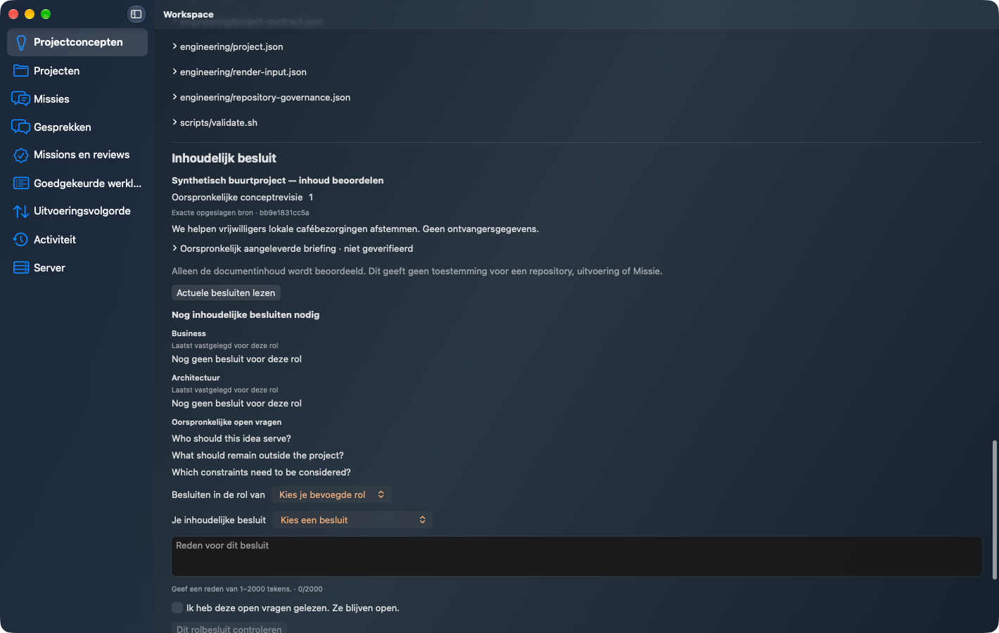

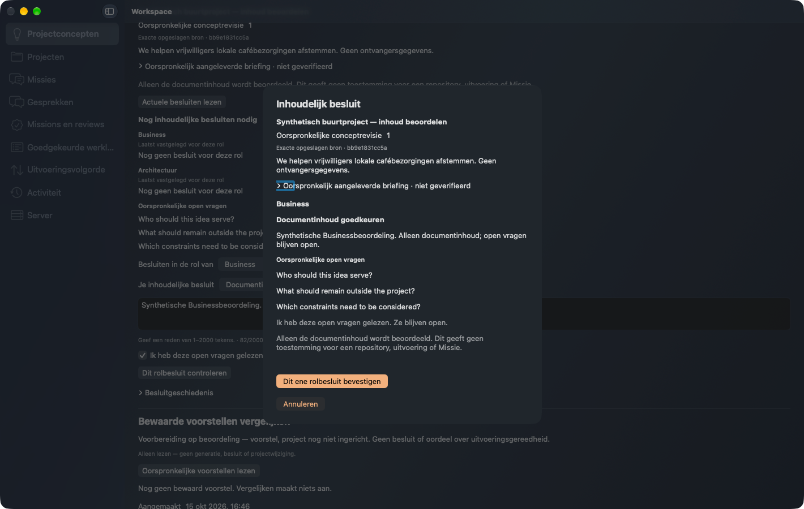

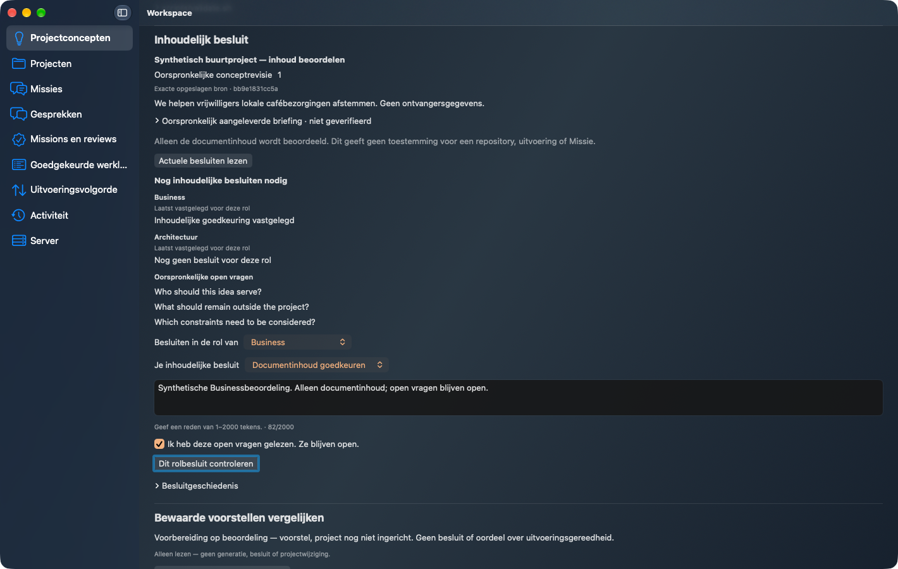

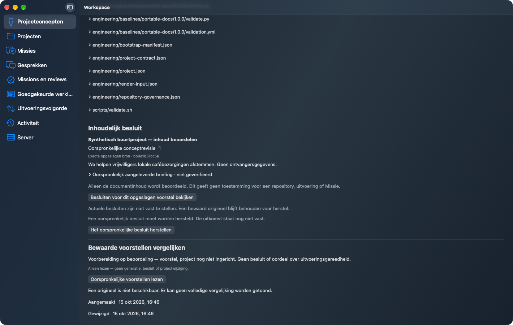

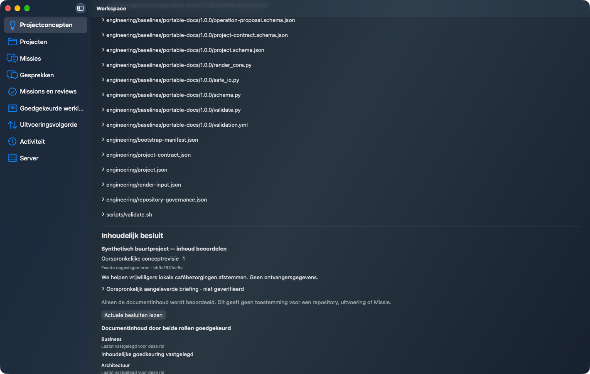

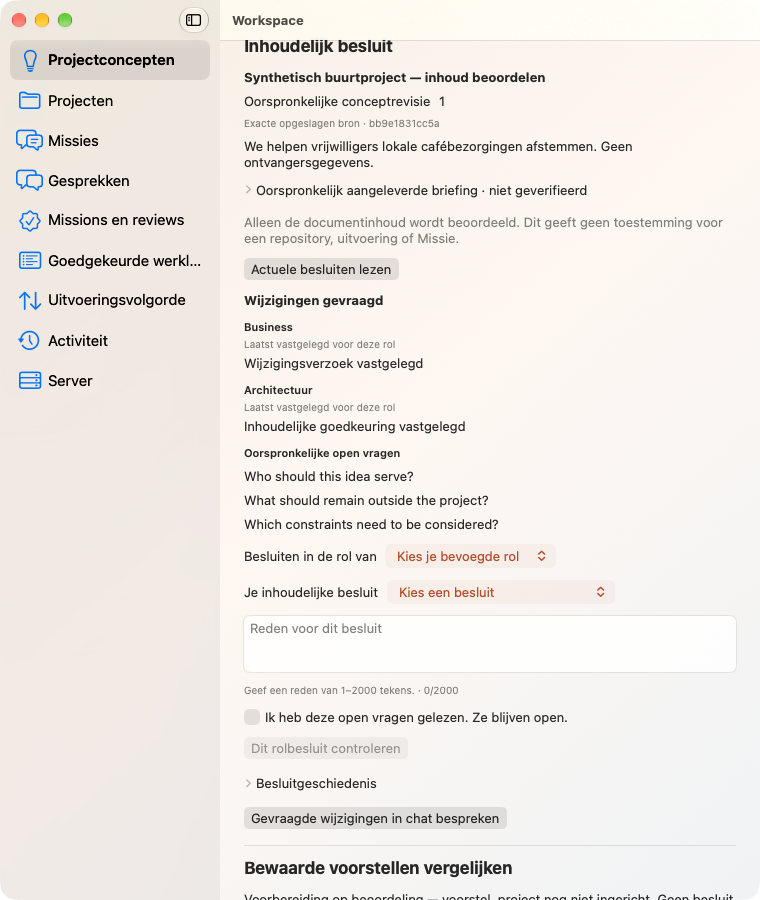

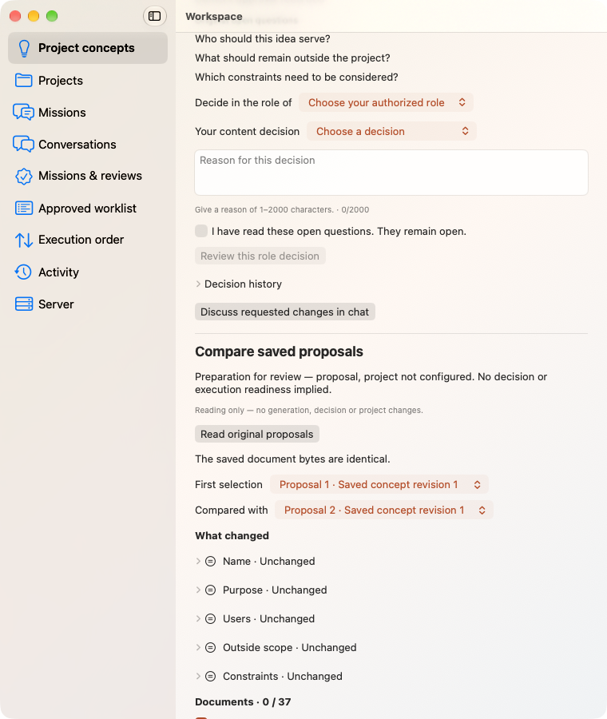

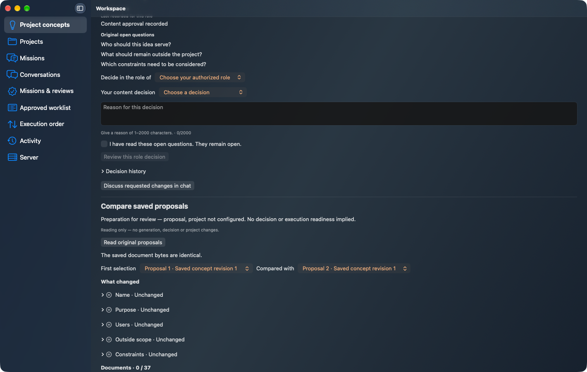

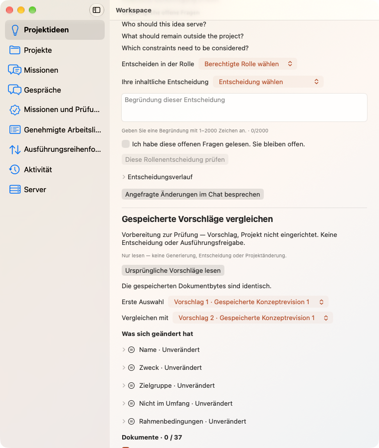

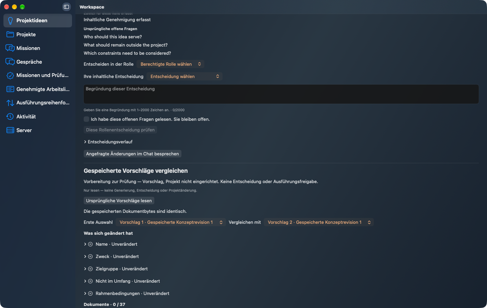

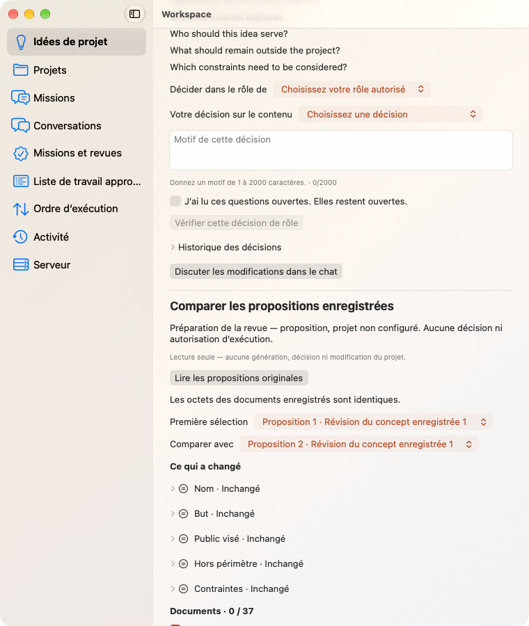

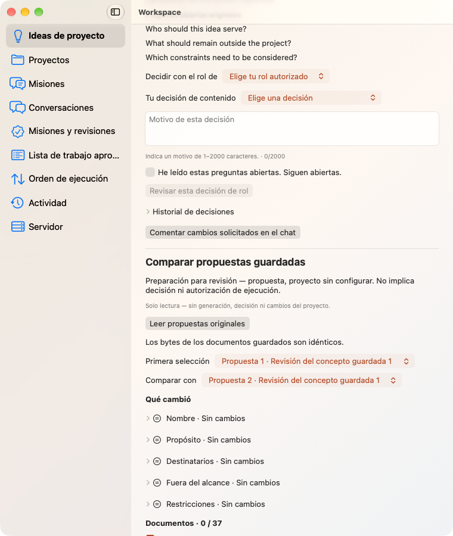

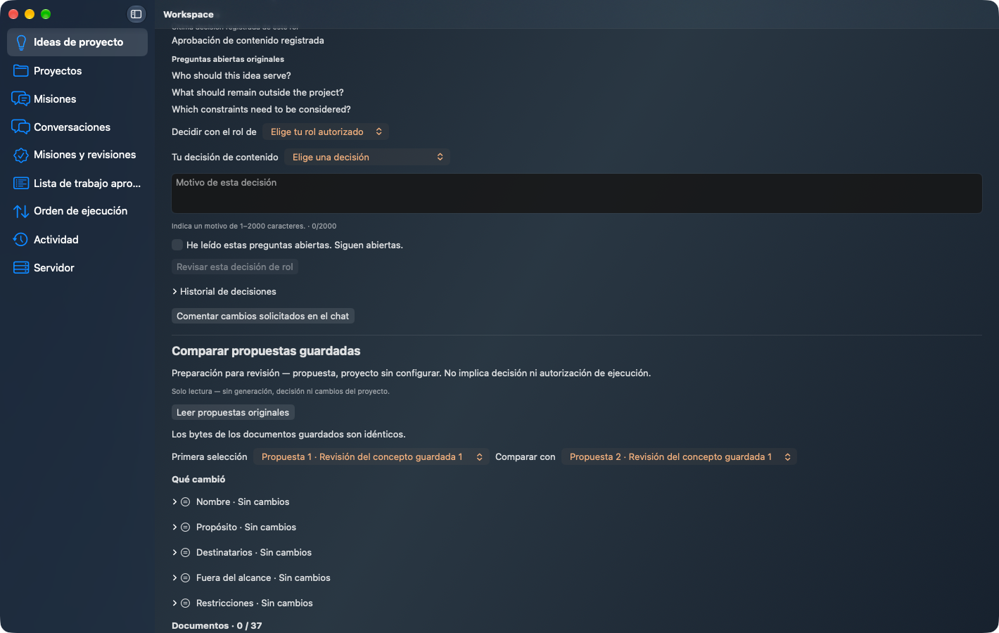

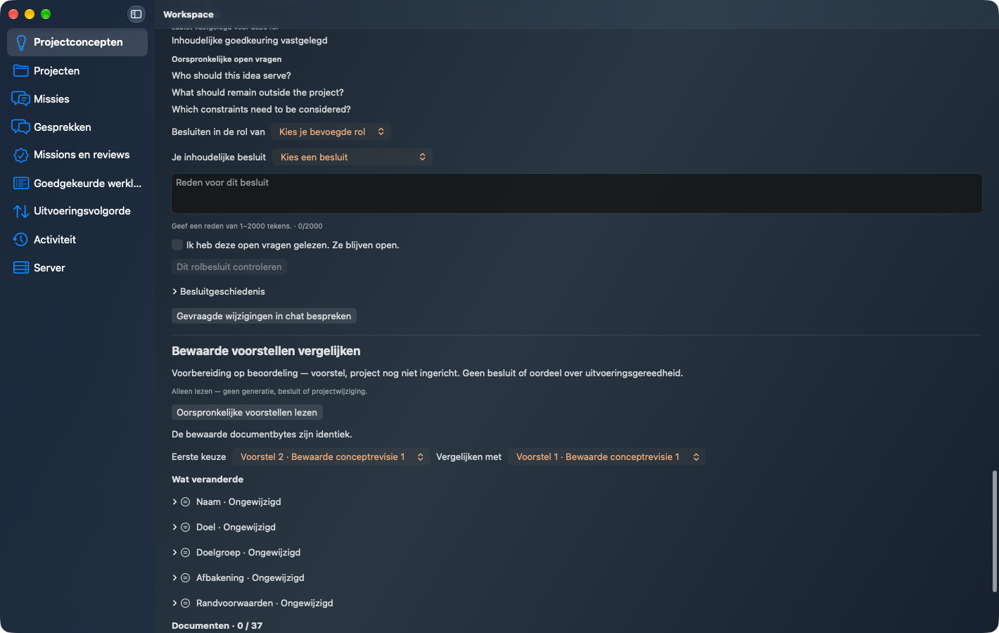

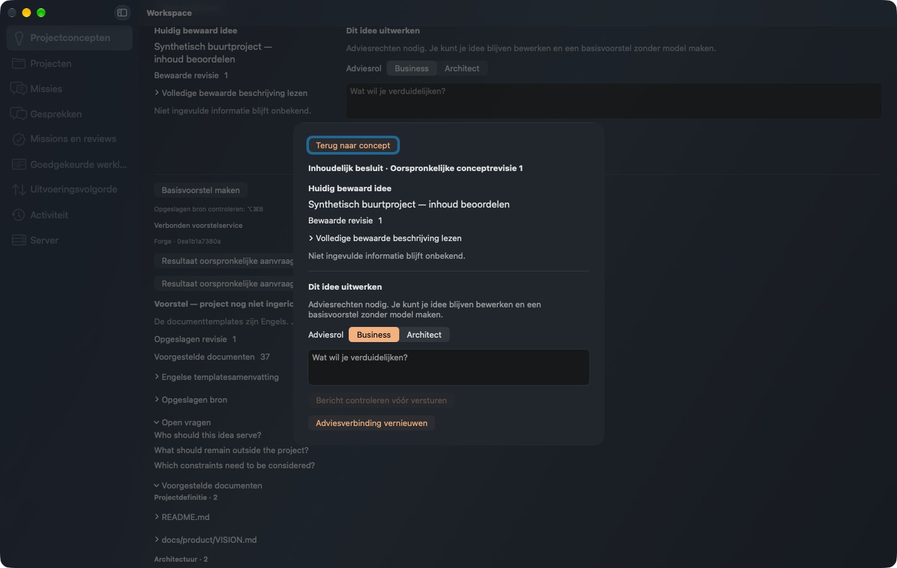

