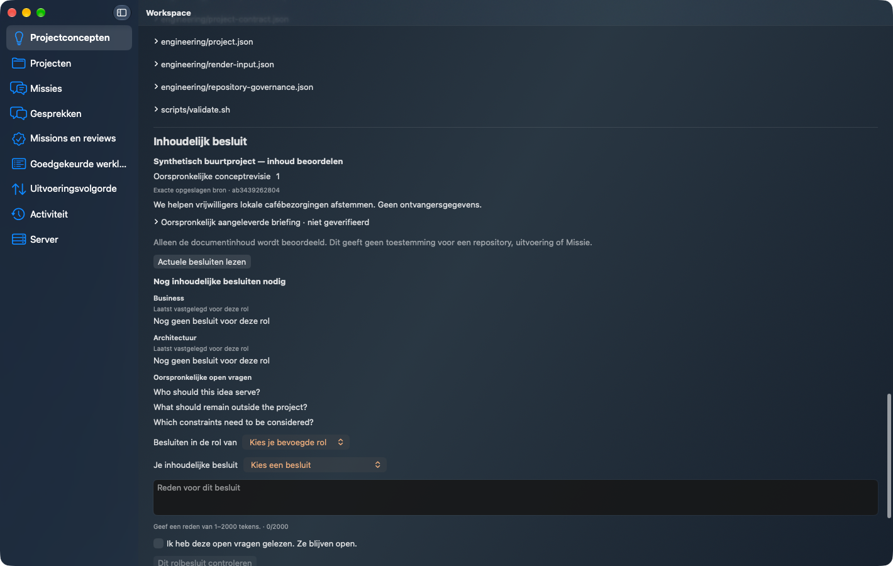
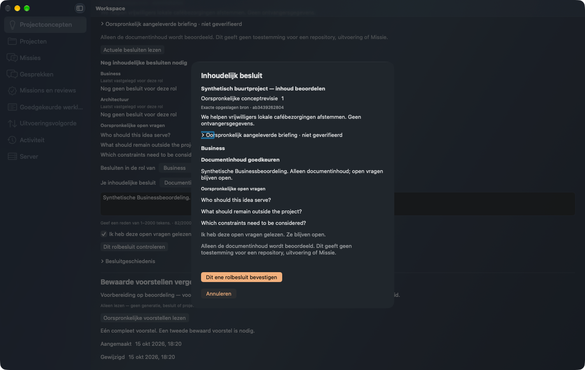
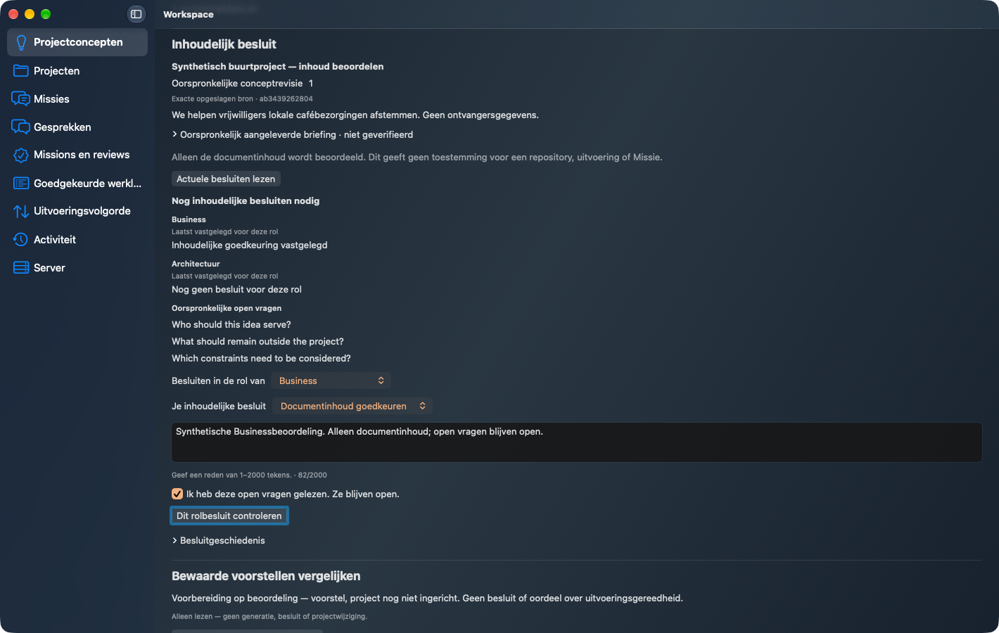
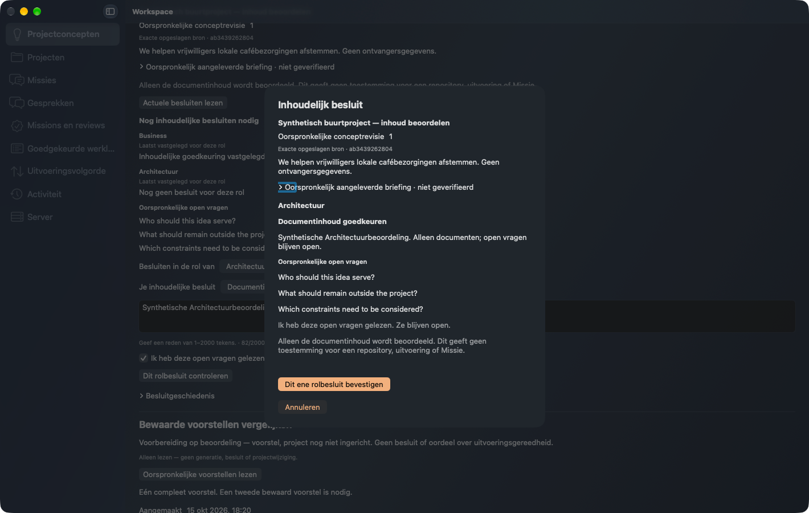
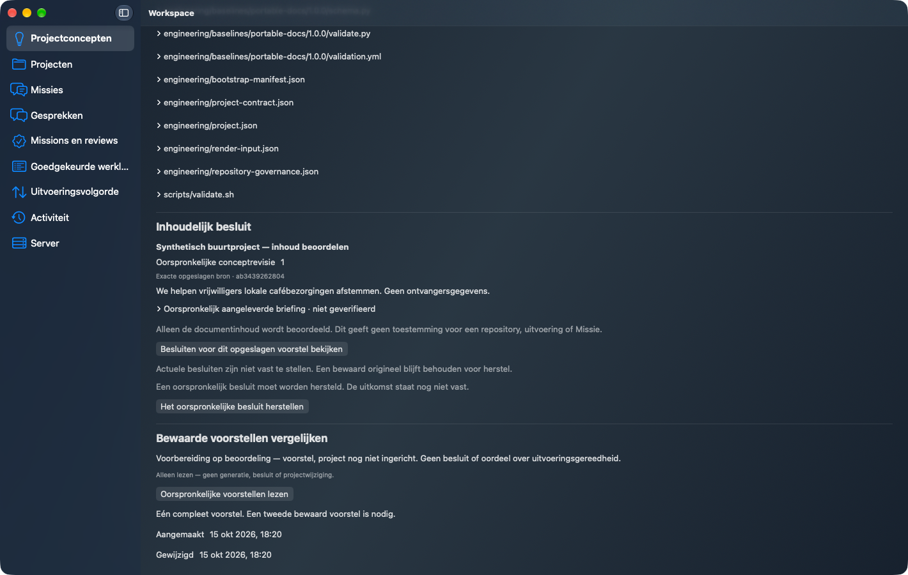
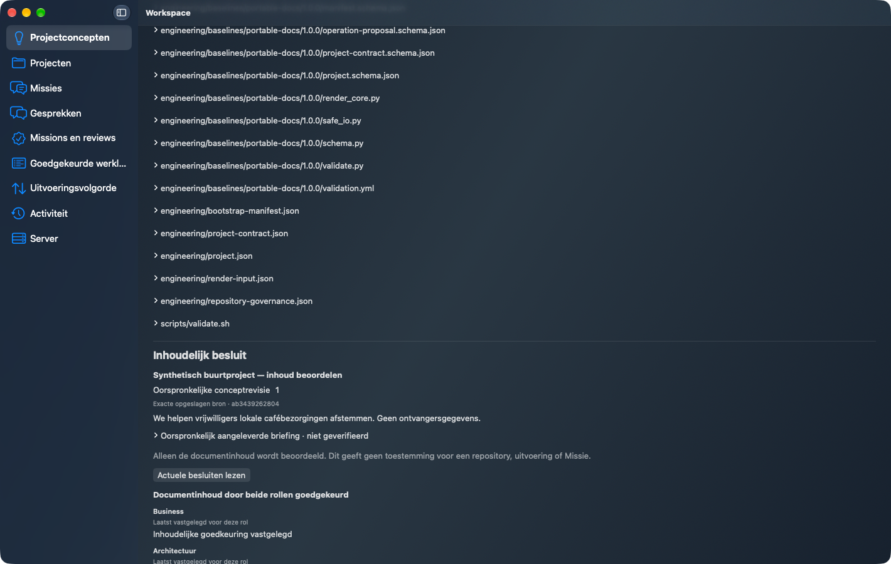
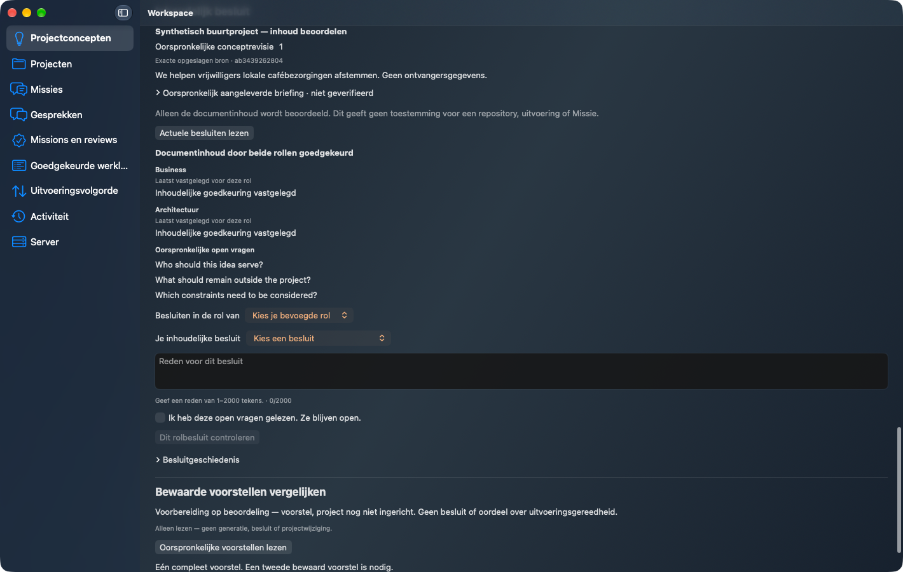
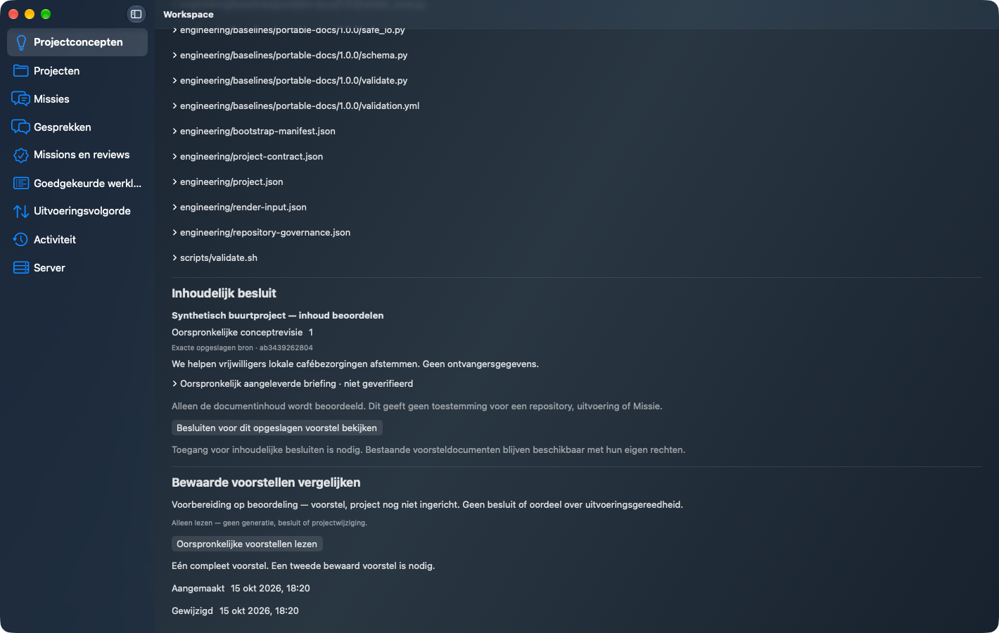

# Plan106 — new exact-final-main installed native content decisions

Workspace2.8.30 exact`80f51fcfe2c90d1b3cbbef10702f6c8c300e426d` after protected implementationPR179 and own nonempty finalizationPR180. Qualified Forge2.20.0/0ea1b1a, handoff6195333957. This is a NEW build and noneditable outside-checkout installation of final-main Client/Server with real qualified Forge HTTP, not a relabeled candidate binary or screenshot. Exact source/wheel/install payloads and new native source/binary hashes are in summary.json; actual Mach-O SDK26.0/minimum26.0 and separate toolchain SDK query27.0 are distinguished. Producer wheel is our distinct build of the exact qualified source.

Actual native original R52 preparation yields37 documents. Two explicit separate role confirmations create Business-only partial status then both-role document-content approval. One genuine committed Architecture reply is lost; separate Client/Server OS restarts recover the original operation/digest with exactly one effect per command and no additional POST. Real grant revocation conceals protected decisions. Original R52 bytes stay unchanged. Zero model, EP, repository, apply or Mission effects; technical people/decisions are synthetic and are not Peter's real business approval.

Cleanup COMPLETE before the original fixed deadline with zero errors; own finite grants, pairings, processes and listeners are closed. No user credentials, global installation, signing policy, permissions or system settings changed. Earlier exact-source compact matrix, five-language/lightdark/narrowwide/keyboard observations, negative control and failed oracles remain at their original sources in the [candidate observations](https://github.com/pcvantol/workspace/tree/97f2a4a98a49c72e78986fd1c9daa21f32dd7a44/docs/qualification/plan106-candidate-observations-20261015) and [qualified refactor candidate](https://github.com/pcvantol/workspace/tree/d685af101ab1b1f01780c63c3c826034f691f5ad/docs/qualification/plan106-qualified-candidate-20261015). Unchanged matrices were not blindly repeated.

Full required validations and independent source/candidate/finalization reviews are recorded separately; actual TDE assessmentPASS_WITH_WARNINGS/repositoryQUALIFIED is distinct from workflowSUCCESS and retains historical FAIL32. The fresh final-main images and runtime receipts require independent final evidence/pixel/metadata acceptance before public delivery. Only original approved bytes are published; immutable remote readback is recorded separately. Parent roadmap families remain open. Plan105/LINK/predecessors stay closed; no next feature started.

