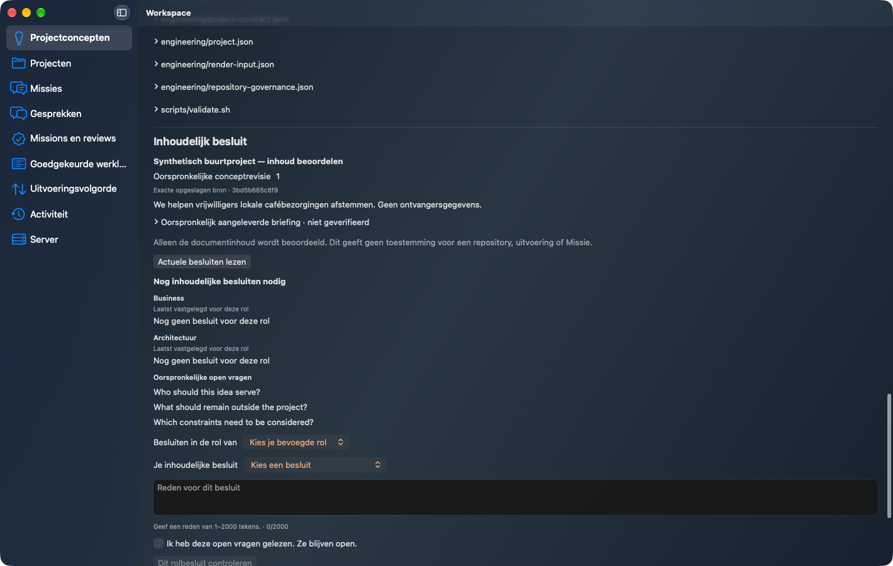
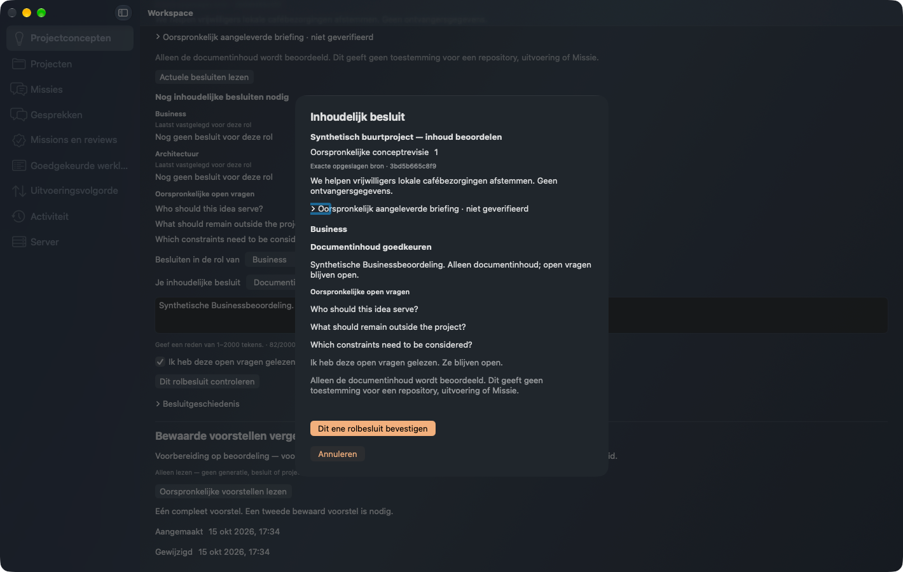
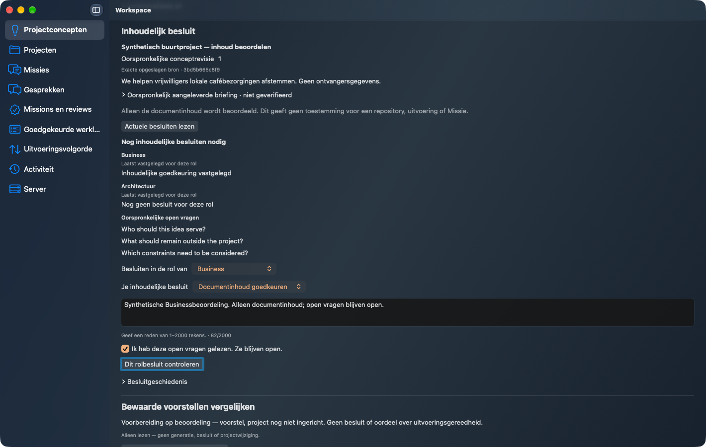
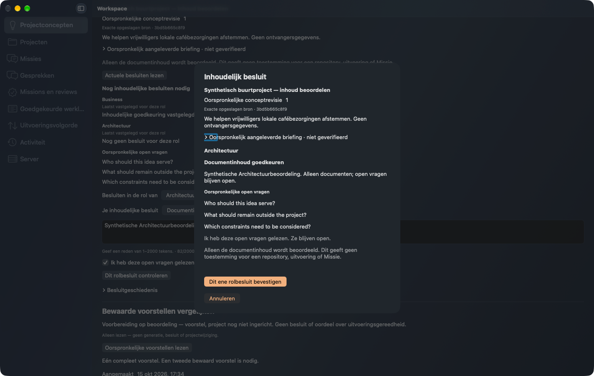
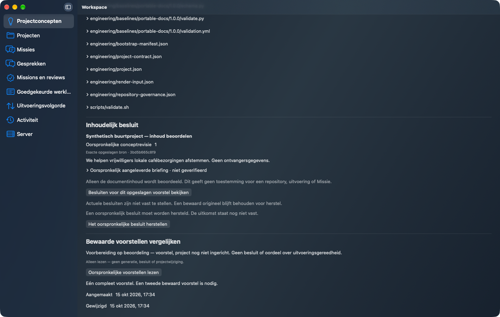
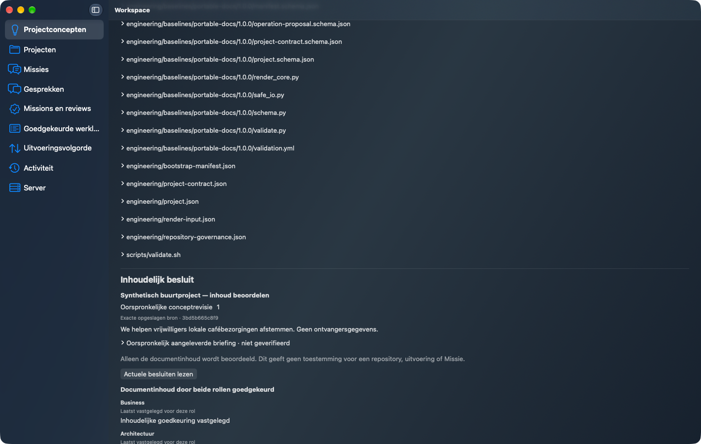
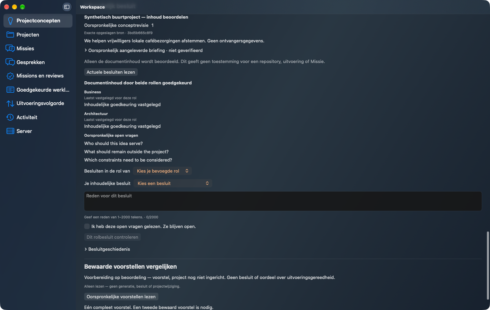
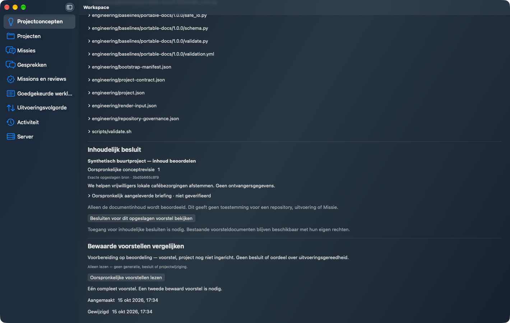

# Plan106 qualified refactor candidate

Exact Workspace8e5301b /2.8.30, qualified Forge2.20.0/0ea1b1a, handoff6195333957. This is source-bound candidate evidence; protected implementation/finalization and NEW exact-final-main evidence remain separate required gates.

Fresh outside-checkout noneditable Client/Server/Forge installation independently verifies66 Workspace,331 Forge and229 native source payloads. Producer wheel is our distinct build of the qualified source. Actual Mach-O SDK26.0/minimum26.0; available-toolchain SDK query27.0 is separate.

One actual native R52 PREPARE produces37 original documents. Two separate explicit native confirmations record synthetic Business then Architecture decisions: one role stays partial, both approve document content only. A genuine committed reply is deliberately lost; separate Client and Server OS restarts recover exactly the same original operation and request digest without another POST. Actual revocation conceals protected decision data through the extracted monitor. Original R52 identity and bytes remain unchanged; zero model/EP/repository/Mission effects. These technical synthetic decisions are not Peter's real business approval.

Cleanup COMPLETE with zero errors before the original fixed deadline, all own test rights/pairings revoked, four own processes/listeners stopped. The earlier broad Tab observer edited only an unsaved synthetic local form; current-source guard correctly disabled decision submission. Saved notes/revision were independently verified unchanged; those failed diagnostic observations are retained privately and not relabeled as keyboard acceptance. This focused proof uses genuine visible pointer and keyboard events without settings or permission changes.

All eight original PNGs below passed independent UX pixel and Security metadata/privacy review. Original bytes retained. The earlier complete role/CAS/authority/concurrency/capacity/ten-locale-layout matrix stays at its original source in the linked [candidate observations](https://github.com/pcvantol/workspace/tree/97f2a4a98a49c72e78986fd1c9daa21f32dd7a44/docs/qualification/plan106-candidate-observations-20261015); it was not needlessly repeated or relabeled.

Full validation2 PASS328Python/320native+1isolated; strict per-production-source coverage>80.2%. Previous source actual TDE FAIL32>30 remains retained. New exact-head TDE/CI readback is recorded separately in summary.json when observed.

